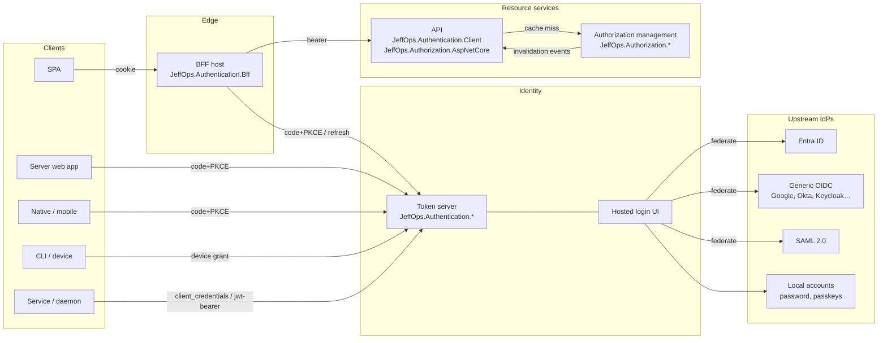

# JeffOps.Authentication — Design

| | |
|---|---|
| Status | Draft v0.1 |
| Date | 2026-10-15 |
| Owner | Jeff Wouters |
| Target | .NET 10, C# |
| Solution | `JeffOps.Authentication` (part of the public JeffOps library family) |

This document is the reference design for a generic, reusable authentication and authorization solution built as a set of .NET class libraries. It records what exists today in the origin implementation (§2), what we keep, what we generalise, and where we are going. When in doubt during implementation, this document wins; when this document is wrong, update it in the same change.

All packages use the `JeffOps.` prefix. `JeffOps.Authentication` is the solution name. Authentication packages are named `JeffOps.Authentication.*`, authorization packages `JeffOps.Authorization.*`, and the shared hardening package is `JeffOps.Security.AspNetCore`. The packages will be published publicly under the JeffOps brand, alongside future JeffOps solutions.

> Origin-specific material is kept outside this repository (§2, D14).

---

## Contents

1. [Purpose and scope](#1-purpose-and-scope)
2. [Origin](#2-origin)
3. [Goals and non-goals](#3-goals-and-non-goals)
4. [Design principles](#4-design-principles)
5. [Architecture overview](#5-architecture-overview)
6. [Architecture and package map](#6-architecture-and-package-map)
7. [Authentication server](#7-authentication-server)
8. [Identity providers (upstream)](#8-identity-providers-upstream)
9. [Client hosting models](#9-client-hosting-models)
10. [Claims contract](#10-claims-contract)
11. [Authorization](#11-authorization)
12. [Delegated and privileged access module](#12-delegated-and-privileged-access-module)
13. [Extension points](#13-extension-points)
14. [Data model](#14-data-model)
15. [Events](#15-events)
16. [Security baseline](#16-security-baseline)
17. [Improvements over the origin implementation](#17-improvements-over-the-origin-implementation)
18. [Open decisions](#18-open-decisions)
19. [Roadmap](#19-roadmap)
20. [Testing strategy](#20-testing-strategy)
21. [Glossary](#21-glossary)

---

## 1. Purpose and scope

Provide a self-hostable identity and access layer for multi-tenant .NET SaaS products:

- **Authentication**: an OpenID Connect / OAuth 2.x token server that federates to upstream identity providers (Entra ID and others) and issues its own platform tokens.
- **Authorization**: permission-based RBAC over a scope hierarchy, with ABAC policies and subtractive ceilings, evaluated locally inside each resource service.
- **Client integration**: libraries that let SPAs, server-rendered web apps, native apps, CLIs and services obtain and use those tokens, with the BFF pattern as the default for browsers.

In scope: libraries, a reference host for the token server, a reference host for authorization management, and a reference BFF host.

Out of scope for v1: a hosted admin UI, billing/entitlement *management* (we only consume entitlement checks), SCIM server (roadmap), SAML (roadmap).

---

## 2. Origin

The design is extracted from a private multi-tenant SaaS platform where these capabilities run in production: an OpenIddict token server federating to Entra ID, permission-based authorization with local evaluation, and a BFF gateway. Sections 7–12 describe what is kept, generalised or added. Wherever this document says "source", "kept" or "ported", it refers to that origin implementation.

Origin-specific material is kept privately and is deliberately not part of this repository (D14). That covers the file-level source map, the capabilities and gaps inherited from the origin, and the origin's known issues.

---

## 3. Goals and non-goals

### Goals

- **G1 — Standards first.** Every client talks standard OIDC/OAuth. Custom grants exist only where no standard fits (and are named in a configurable URN namespace).
- **G2 — Pluggable upstream identity.** Entra is one provider among many; adding Google, Okta or a customer's own IdP is configuration, not code.
- **G3 — Pluggable client hosting.** BFF is the default for browsers, not a requirement.
- **G4 — Product-agnostic.** No hard-coded product names, permission codes, role names, claim names or client ids. Everything product-specific comes from options or providers.
- **G5 — Modular.** Consumers reference only what they use. Delegation (impersonation, lockbox, tenant switch), entitlements and governance are optional modules.
- **G6 — Secure by default, fail closed.** Missing secrets, dev keys outside Development, or unreachable dependencies refuse rather than degrade.
- **G7 — Keep what works.** Preserve the hardened behaviour and tests of the source; don't regress during extraction.

### Non-goals

- Replacing a commercial IdP for workforce identity. We federate to one; we don't compete with one.
- Carrying permissions in tokens. Tokens carry identity and context; permissions are resolved at the resource.
- Supporting .NET versions older than 10.

---

## 4. Design principles

1. **The token server owns the login.** Clients never present upstream IdP tokens directly to resource services. Upstream tokens are exchanged at the token server, which issues platform tokens. (Today the SPA owns the Entra login via MSAL; this changes — see §7.2.)
2. **Revalidate from live state.** Every refresh rebuilds claims from current account, membership, tenant and MFA state. Never re-sign a stored principal.
3. **Identity in the token, authority at the resource.** Tokens carry `sub`, tenant context and ceilings. Permissions are resolved locally from cached role assignments.
4. **Ceilings only narrow.** PAT, delegation, step-up and impersonation rules can remove access, never add it.
5. **Deny overrides.** An ABAC Deny beats every Permit, including Root.
6. **Immutable account keys.** External accounts are linked on `(issuer, subject)`, never on email.
7. **Secrets never in the browser.** Under BFF, no platform token reaches the browser.
8. **Abstractions in, products out.** Anything that names a product concept is an option, a provider interface, or lives in an optional module.
9. **Drift tests guard invariants.** Security invariants are enforced by architecture tests, not code review.
10. **Clean Architecture, vertical slices, minimal APIs.** Dependencies point inward. Code is organised by use case. Every HTTP endpoint is a minimal API. No mediator library (§6.1).
11. **Free and permissive dependencies only.** No paid, dual-licensed or licence-key-gated packages (§6.5).

---

## 5. Architecture overview



Three deployable roles, all optional and composable:

| Role | Built from | Notes |
|---|---|---|
| Token server | `Authentication.{Domain, Application, Infrastructure, Persistence.*, Endpoints, UI}` + one or more `Federation.*` plug-ins + optional `LocalAccounts` / `Delegation` | Hosts OIDC endpoints and the login UI. |
| Authorization management | `Authorization.{Domain, Application, Infrastructure, Persistence.*, Endpoints}` | Roles, assignments, policies, scopes, governance. May be co-hosted with the token server. |
| BFF | `Bff` + optional `Bff.Yarp` | Only needed for the BFF browser model. |

Resource services only reference `Authentication.Client` and `Authorization.AspNetCore`. The latter brings in `Authorization.Domain`, which is pure code.

---

## 6. Architecture and package map

### 6.1 Architecture style

Three rules apply together everywhere in the solution:

1. **Clean Architecture** decides the *direction of dependencies*. A module is split into Domain → Application → Infrastructure / Endpoints, and dependencies only point inward:
   - Domain depends on nothing except the SharedKernel.
   - Application depends on Domain, the SharedKernel and Abstractions.
   - ASP.NET Core, EF Core, OpenIddict and Azure SDKs appear only in Infrastructure, Endpoints and plug-ins.
2. **Vertical slices** decide *how code is organised inside a layer*. Code is grouped by use case, not by technical type: a project has `Features/PersonalAccessTokens/CreatePat/`, not top-level `Services/`, `Repositories/` or `Dtos/` folders. A slice owns its input, output, handler, validation and endpoint. Slices share only Domain types and ports. A slice never references another slice.
3. **Minimal APIs** for the whole HTTP surface. There are no MVC controllers.
   - Each slice has one endpoint class with a static `Map` method.
   - Each module exposes one `MapJeffOps{Module}()` extension method that the host calls.
   - Endpoints return `TypedResults`, report errors as RFC 9457 ProblemDetails, and declare their authorization and OpenAPI metadata explicitly.
   - The hosted login UI (§8) uses Razor components with static server-side rendering (`MapRazorComponents`), which needs no controllers either.

**How the rules combine.** A slice's folder path is mirrored in each layer project, so a use case sits in the same place everywhere:

```
JeffOps.Authentication.Domain/PersonalAccessTokens/
    PersonalAccessToken.cs          // aggregate: expiry caps, revoke rules, ceiling invariants
JeffOps.Authentication.Application/Features/PersonalAccessTokens/CreatePat/
    CreatePatCommand.cs             // input record
    CreatePatResult.cs              // output record
    CreatePatHandler.cs             // use case: ICommandHandler<CreatePatCommand, CreatePatResult>
    CreatePatValidator.cs           // rules beyond DataAnnotations (only if needed)
JeffOps.Authentication.Endpoints/Features/PersonalAccessTokens/
    CreatePatEndpoint.cs            // POST /pat: HTTP contract → command → TypedResults
```

**Handlers without a mediator.** The solution uses no MediatR and no other dispatcher library. The SharedKernel defines:

```csharp
public interface ICommandHandler<in TCommand, TResult>
{
    Task<Result<TResult>> HandleAsync(TCommand command, CancellationToken cancellationToken);
}

public interface IQueryHandler<in TQuery, TResult>
{
    Task<Result<TResult>> HandleAsync(TQuery query, CancellationToken cancellationToken);
}
```

- Endpoints inject the handler interface directly:

  ```csharp
  static async Task<IResult> Handle(
      CreatePatRequest request,
      ICommandHandler<CreatePatCommand, CreatePatResult> handler,
      CancellationToken ct)
      => (await handler.HandleAsync(request.ToCommand(), ct)).ToHttpResult();
  ```

- Each module's `AddJeffOps{Module}()` registers its handlers explicitly. There is no runtime assembly scanning, so the code is trim/AOT-friendly and every registration is visible in review. An architecture test fails if a handler exists that isn't registered.
- Cross-cutting concerns in the application (logging, validation, audit, unit of work) are **decorators** around the handler interfaces. A small hand-written helper in the SharedKernel applies them, so there's no Scrutor dependency.
- HTTP concerns (step-up, impersonation refusal, entitlement checks, rate limiting) are **endpoint filters** and route conventions.
- **Domain events:** aggregates raise them; the unit of work collects them on save. An in-process dispatcher in the SharedKernel (`IDomainEventHandler<T>`, about 50 lines) runs them. Handlers that must reach other systems translate them into integration events through `IEventPublisher` and the outbox.

**Results and errors.**
- Expected failures never throw. Handlers return `Result<T>` / `Error(Code, Message, Type)` from the SharedKernel.
- Endpoints map `ErrorType` to a status code: Validation 400, Unauthorized 401, PaymentRequired 402, Forbidden 403, NotFound 404, Conflict 409.
- Errors are returned as ProblemDetails with a `code` extension. The source's error codes (`step_up_required`, `impersonation_not_allowed`, `mfa_required`, …) are kept.

**Validation**, in three levels:
- Shape: .NET 10's built-in minimal API validation (`AddValidation()`, DataAnnotations on request records).
- Rules that need logic: plain slice validators implementing the SharedKernel's `IValidator<T>`, run by the validation decorator.
- Invariants: enforced inside the domain entities.

No validation library is added, so consumers' dependency graphs stay small.

**Mapping** is hand-written: static `ToCommand()` / `ToResponse()` methods next to the slice. No AutoMapper or Mapster.

**OpenIddict inside this structure.**
- OpenIddict owns the protocol: routing, OAuth parameter validation, token serialization, client authentication. It runs in passthrough mode.
- A single minimal API endpoint receives the validated OpenIddict request and dispatches by grant type to one application handler per grant: `Features/Grants/ExchangePat`, `Features/Grants/RefreshSession`, `Features/Grants/ClientCredentials`, `Features/Grants/AuthorizationCode`, and so on.
- Each grant handler returns an `IssuedIdentity` (subject, claims, destinations, lifetimes). The endpoint turns it into an OpenIddict `SignIn`.
- Protocol details stay in Infrastructure and Endpoints; business rules stay in Application.

### 6.2 Modules and projects

There are three kinds of project:
- **Layered modules** (Authentication, Authorization): one project per layer.
- **Plug-ins**: implement a port of a layered module.
- **Adapters and optional feature modules**: a single project each.

A layered module also ships a separate persistence project per database provider. Migrations are provider-specific (D3).

**Shared**

| Project | Contents | Depends on |
|---|---|---|
| `JeffOps.Authentication.SharedKernel` | `Result`/`Error`, handler and validator interfaces, decorator helper, domain event base and dispatcher, `Entity`/`AggregateRoot` base, strongly-typed id base | Microsoft.Extensions.DependencyInjection.Abstractions only |
| `JeffOps.Authentication.Abstractions` | Public surface for hosts and consumers: `ICurrentUser`, `IClaimNames` and claim defaults, host ports (`ITenantDirectory`, `IAuditSink`, `IEventPublisher`, `INotifier`, `IDomainPolicy`), HTTP contracts, integration events | — |

**Authentication module (token server)**

| Project | Layer | Contents | Depends on |
|---|---|---|---|
| `JeffOps.Authentication.Domain` | Domain | `Account`, `ExternalLogin`, `LocalCredential`, `PersonalAccessToken`, `TokenKey`, `AccountErasure`; value objects (`Issuer`, `Subject`, `PatHash`, `SessionLifetime`); domain events; invariants (PAT expiry caps, status transitions) | SharedKernel |
| `JeffOps.Authentication.Application` | Application | Slices: `Grants/*`, `Accounts/*`, `PersonalAccessTokens/*`, `Sessions/Revalidate`, `Federation/*` (account linking on `(issuer, subject)`, home realm discovery, per-tenant provider registry). Ports: `IAccountRepository`, `IPatRepository`, `ITokenKeyProvider`, `IExternalIdentityProvider`, `IPasswordHasher`, `IUnitOfWork`. Time comes from `TimeProvider`. | Domain, Abstractions |
| `JeffOps.Authentication.Infrastructure` | Infrastructure | OpenIddict server configuration, key providers (database, certificate) and rotation, hashing, provider-neutral EF Core `DbContext` and repositories, client seeder, background sweepers | Application, OpenIddict, EF Core |
| `JeffOps.Authentication.Persistence.SqlServer` | Infrastructure | SQL Server provider registration and migrations | Infrastructure |
| `JeffOps.Authentication.Endpoints` | Presentation | Minimal API endpoint per slice, `MapJeffOpsAuthentication()`, ProblemDetails mapping | Application, ASP.NET Core |
| `JeffOps.Authentication.UI` | Presentation | Hosted login, provider picker, MFA prompt, consent (Razor components, static SSR) | Application, ASP.NET Core |

**Authentication plug-ins** (each implements an Application port)

| Project | Implements | Depends on |
|---|---|---|
| `JeffOps.Authentication.KeyVault` | `ITokenKeyProvider` (Key Vault / Managed HSM, non-exportable) | Application, Azure SDK |
| `JeffOps.Authentication.Federation.Entra` | `IExternalIdentityProvider` (Entra ID, `amr`/`acrs` mapping) | Application, OpenIddict.Client |
| `JeffOps.Authentication.Federation.Oidc` | `IExternalIdentityProvider` (generic OIDC/OAuth2, OpenIddict WebIntegration catalog) | Application, OpenIddict.Client |
| `JeffOps.Authentication.Federation.Saml` | `IExternalIdentityProvider` (SAML 2.0, roadmap) | Application, SAML library (D5) |

**Optional feature modules** (single project, one folder per layer; D17)

| Project | Contents | Depends on |
|---|---|---|
| `JeffOps.Authentication.LocalAccounts` | Passwords, passkeys, TOTP, email OTP / magic links, lockout, reset, verification | Authentication.Application |
| `JeffOps.Authentication.Delegation` | Impersonation, lockbox tenant access, tenant switch (§12) | Authentication.Application |

Inside these projects the `Domain/`, `Application/`, `Infrastructure/` and `Endpoints/` folders follow the same rules as separate projects. Architecture tests enforce this by namespace.

**Authorization module**

| Project | Layer | Contents | Depends on |
|---|---|---|---|
| `JeffOps.Authorization.Domain` | Domain | `Permission` matching, `Role`, `Assignment`, `Scope` / `ScopeHierarchy`, `AttributePolicy` and condition model, `PolicyDecisionEngine`, ceilings, decision pipeline. Pure code. **Also referenced by resource services.** | SharedKernel |
| `JeffOps.Authorization.Contracts` | Contracts | Wire contracts shared by management and resource services: read-API DTOs, route constants, integration events (cache invalidation). Pure. | Authorization.Domain, Abstractions |
| `JeffOps.Authorization.Application` | Application | Slices: `Roles/*`, `Assignments/*`, `RoleChanges/*` (4-eyes), `Policies/*`, `Scopes/*`, `Permissions/Register`, `Decisions/Simulate`, `Governance/SweepExpired`. Ports: repositories, `IGroupMembershipProvider`, catalog and role providers. | Domain, Abstractions |
| `JeffOps.Authorization.Infrastructure` | Infrastructure | EF Core context, change interceptor (emits invalidation events), sweepers, seeding from providers | Application, EF Core |
| `JeffOps.Authorization.Persistence.SqlServer` | Infrastructure | SQL Server registration and migrations | Infrastructure |
| `JeffOps.Authorization.Endpoints` | Presentation | Minimal APIs, `MapJeffOpsAuthorization()` | Application, ASP.NET Core |
| `JeffOps.Authorization.AspNetCore` | Adapter for resource services | Policy provider, requirement handler, step-up/impersonation result handler, endpoint conventions, `IAuthorizer`, cached resolver, sealed cache, read client for management endpoints | Authorization.Domain, Abstractions, ASP.NET Core |

**Client and edge adapters** (single project each, organised by feature, no business rules)

| Project | Contents |
|---|---|
| `JeffOps.Authentication.Client` | JwtBearer setup for resource services, audience rules, fallback policy, `ICurrentUser` implementation, `ServiceTokenProvider` / `ServiceTokenHandler` |
| `JeffOps.Authentication.Bff` | Slices as minimal API endpoints (`Login`, `Callback`, `Logout`, `Me`, `SessionContext`); `Sessions/` (store, manager, single-flight refresh); cookie→bearer and CSRF middleware |
| `JeffOps.Authentication.Bff.Yarp` | YARP transforms: strip cookie, attach bearer, PAT→JWT edge exchange |
| `JeffOps.Security.AspNetCore` | Security headers, forwarded-headers hardening, CORS defaults, Data Protection (Redis + KEK), origin lock, rate-limit partitions |
| `JeffOps.Entitlements` | `IEntitlementChecker` (default: allow all), `RequireEntitlement(name)` endpoint convention answering 402 with `code: entitlement_required` and the entitlement's name (optional) |
| `JeffOps.Authentication.Testing` | `TestTokenIssuer` + `TestPrincipal` (signed tokens following the claims contract, trusted through `AddJeffOpsTestTokens`), `FakeCurrentUser`, `FakeAccessContextAccessor` |

### 6.3 Dependency rules

```
Domain          → SharedKernel
Application     → Domain, SharedKernel, Abstractions, Microsoft.Extensions.*.Abstractions
Infrastructure  → Application (+ EF Core, OpenIddict, …)
Endpoints / UI  → Application (+ ASP.NET Core)        never → Infrastructure
Plug-ins        → Application                         never → Infrastructure, Endpoints
Hosts           → everything (composition root)
```

- Endpoints never reference Infrastructure. Only the host composes the two.
- No slice references another slice: no type in `Features.X` may use a type in `Features.Y`. Shared rules belong in Domain, shared I/O behind a port.
- `JeffOps.Authorization.*` never depends on `JeffOps.Authentication.*` Domain, Application or Infrastructure. Authorization works with any token issuer that satisfies the claims contract (§10).
- Client-side packages (`Authentication.Client`, `Bff`, `Bff.Yarp`, `Authorization.AspNetCore`) never reference a server Application or Infrastructure project.
- `*.Contracts` projects are pure like Domain and may reference only their own Domain and the kernel. Every layer of the same context, and client adapters, may reference them.
- No project references a message broker. Events go through `IEventPublisher`; adapters ship as separate packages (D7).
- No MVC: `Microsoft.AspNetCore.Mvc.Core` controllers and `ControllerBase` are banned via `BannedSymbols.txt`.
- All of the above is enforced by architecture tests (§20).

### 6.4 Hosts are composition roots

Hosts contain no logic. A token server host looks like this:

```csharp
var builder = WebApplication.CreateBuilder(args);

builder.Services
    .AddJeffOpsAuthentication(builder.Configuration)   // Application + Infrastructure + Endpoints
    .AddSqlServerPersistence(builder.Configuration)
    .AddKeyVaultSigning(builder.Configuration)
    .AddEntra(builder.Configuration)
    .AddOidcProvider("google", builder.Configuration)
    .AddLocalAccounts(builder.Configuration);

var app = builder.Build();

app.UseJeffOpsSecurity();
app.MapJeffOpsAuthentication();
app.MapJeffOpsLocalAccounts();
app.Run();
```

### 6.5 Third-party dependency policy

**Rules**
1. Only permissive OSI licences are allowed, anywhere in the solution (shipped packages, tests, tools, samples): **MIT, Apache-2.0, BSD-2-Clause, BSD-3-Clause**.
2. No commercial, dual-licensed, source-available or licence-key-gated packages. This includes "free for small companies" community tiers.
3. Prefer the BCL and `Microsoft.Extensions.*` over third-party libraries. Every dependency of a shipped package becomes a transitive dependency for consumers.
4. Re-check the licence on every major version bump. Several popular .NET libraries moved to commercial licences in a major version.
5. Enforcement:
   - `Directory.Build.targets` fails the build when a banned package id is referenced.
   - A licence scan fails on any licence not on the allow-list: the architecture test `Every_resolved_package_has_a_permissive_licence` reads every restored package's nuspec (direct and transitive) and checks its licence expression; packages that only carry a licence URL are allowed when the URL is on a reviewed list. No third-party scanning tool is needed.
   - It covers the reference hosts and samples too, and judges a package by what it ships: a package restored with every asset excluded (`ExcludeAssets="all"`) counts as not shipped.
   - No exceptions (D24). SQL Server support uses `Microsoft.Data.SqlClient` 7.x, which moved Entra authentication (and the MSAL broker's proprietary native interop) to an optional package. SqlClient's native networking (`Microsoft.Data.SqlClient.SNI.runtime`, Microsoft licence terms) is excluded in every project here that resolves SqlClient (root `Directory.Build.props`), and the TokenServer host turns on SqlClient's managed networking (`Switch.Microsoft.Data.SqlClient.UseManagedNetworkingOnWindows`). **For consumers:** SqlClient still brings SNI.runtime on Windows; the `*.SqlServer` packages can't remove it from your graph. To keep it out, add `<PackageReference Include="Microsoft.Data.SqlClient.SNI.runtime" ExcludeAssets="all" PrivateAssets="all" />` to your host and `<RuntimeHostConfigurationOption Include="Switch.Microsoft.Data.SqlClient.UseManagedNetworkingOnWindows" Value="true" />` (Linux and macOS always use managed networking). The packages' design-time factories turn the switch on for `dotnet ef` themselves; the hosts' `migrateOnStartup` path needs nothing extra.

**Banned** (non-exhaustive)

| Package | Reason | Use instead |
|---|---|---|
| FluentAssertions (v8+) | Commercial licence | Shouldly |
| MediatR (v13+) | Commercial licence | Plain handler interfaces (§6.1) |
| AutoMapper (v15+) | Commercial licence | Hand-written mapping |
| MassTransit (v9+) | Commercial licence | `IEventPublisher` + thin adapters on official broker clients |
| Duende IdentityServer, Duende.BFF | Commercial licence | OpenIddict; own BFF (`JeffOps.Authentication.Bff`) |
| Moq | Free, but excluded after the SponsorLink incident (it collected data in the build) | NSubstitute |

**Approved baseline.** Licences are as of 2026-10; re-verify at adoption.

| Purpose | Package | Licence |
|---|---|---|
| OIDC server and client | OpenIddict | Apache-2.0 |
| ORM | EF Core | MIT |
| Reverse proxy | YARP | MIT |
| Cache | `Microsoft.Extensions.Caching.Hybrid`; FusionCache (optional adapter) | MIT; MIT |
| Redis | StackExchange.Redis | MIT |
| Azure | Azure.Identity, Azure.Security.KeyVault.Keys | MIT |
| Test framework | xUnit v3 | Apache-2.0 |
| Assertions | Shouldly | BSD-3-Clause |
| Test doubles | NSubstitute | BSD-3-Clause |
| Containers | Testcontainers | MIT |
| Fake time | Microsoft.Extensions.TimeProvider.Testing | MIT |
| Snapshot tests | Verify (Verify.XunitV3) | MIT |
| Architecture tests | ArchUnitNET or NetArchTest.Rules (D18) | Apache-2.0 / MIT |
| SAML (roadmap) | ITfoxtec.Identity.Saml2 or Sustainsys.Saml2 (D5) | Verify at selection |

### 6.6 Solution layout

```
Z:\Authentication\
  docs\DESIGN.md
  src\
    Shared\
      JeffOps.Authentication.SharedKernel\
      JeffOps.Authentication.Abstractions\
    Authentication\
      JeffOps.Authentication.Domain\
      JeffOps.Authentication.Application\
      JeffOps.Authentication.Infrastructure\
      JeffOps.Authentication.Persistence.SqlServer\
      JeffOps.Authentication.Endpoints\
      JeffOps.Authentication.UI\
      Plugins\
        JeffOps.Authentication.KeyVault\
        JeffOps.Authentication.Federation.Entra\
        JeffOps.Authentication.Federation.Oidc\
      Modules\
        JeffOps.Authentication.LocalAccounts\
        JeffOps.Authentication.Delegation\
    Authorization\
      JeffOps.Authorization.Domain\
      JeffOps.Authorization.Contracts\
      JeffOps.Authorization.Application\
      JeffOps.Authorization.Infrastructure\
      JeffOps.Authorization.Persistence.SqlServer\
      JeffOps.Authorization.Endpoints\
      JeffOps.Authorization.AspNetCore\
    Clients\
      JeffOps.Authentication.Client\
      JeffOps.Authentication.Bff\
      JeffOps.Authentication.Bff.Yarp\
    Common\
      JeffOps.Security.AspNetCore\
      JeffOps.Entitlements\
      JeffOps.Authentication.Testing\
  hosts\
    TokenServer\  AuthorizationService\  Bff\
  samples\
    Spa.Bff\  WebApp\  Cli.Device\  Worker.ClientCredentials\
  tests\
    {Project}.Tests\                         # one per src project
    JeffOps.Authentication.Architecture.Tests\
    JeffOps.Authentication.Security.Tests\
    JeffOps.Authentication.Integration.Tests\
  Directory.Build.props  Directory.Build.targets  Directory.Packages.props
  BannedSymbols.txt  JeffOps.Authentication.slnx
  README.md  LICENSE  SECURITY.md  CONTRIBUTING.md
```

Build settings match the source repo: central package management, `net10.0`, warnings as errors, `NuGetAudit` mode `all`, nullable enabled. Additions for public packages: deterministic builds, SourceLink, package validation.

---

## 7. Authentication server

### 7.1 Endpoints

| Endpoint | Standard | Status in source | Target |
|---|---|---|---|
| `/.well-known/openid-configuration`, JWKS | OIDC Discovery | implicit | explicit, tested |
| `/connect/authorize` | OAuth 2.1 code + PKCE | **missing** | **required** |
| `/connect/token` | RFC 6749 | present | present |
| `/connect/revoke` | RFC 7009 | present | present |
| `/connect/introspect` | RFC 7662 | missing | optional (for opaque-token resource servers) |
| `/connect/userinfo` | OIDC Core | missing | required |
| `/connect/endsession` | OIDC RP-Initiated Logout | missing | required |
| `/connect/device`, `/connect/verify` | RFC 8628 | missing | roadmap |
| `/connect/par` | RFC 9126 (PAR) | missing | roadmap |
| `/account/*` | — | `/auth/register` only | hosted UI (login, register, MFA, reset, passkeys) |

Routes are configurable; the `/auth` prefix of the source becomes an option.

### 7.2 Login ownership change

**Today:** SPA runs MSAL → gets Entra ID token → BFF posts it to `/connect/token` with grant `urn:platform:external`.

**Target:** every interactive client uses authorization code + PKCE against `/connect/authorize`. The token server's login UI picks the upstream provider (home realm discovery), runs the federation server-side through OpenIddict.Client, links the account and issues the platform code. Clients no longer embed any IdP SDK.

The `external` token-exchange grant is **kept** as an optional extension for clients that already hold an upstream token (e.g. native apps using a platform broker), but it is no longer the primary path.

### 7.3 Grants

| Grant | Type | Package | Notes |
|---|---|---|---|
| `authorization_code` + PKCE | standard | Authentication (slice `Grants/AuthorizationCode`) | S256 only; plain PKCE refused. |
| `refresh_token` | standard | Authentication (slice `Grants/RefreshSession`) | Rotation on; claims rebuilt from live state; absolute lifetime from `auth_time`. |
| `client_credentials` | standard | Authentication (slice `Grants/ClientCredentials`) | Non-Root only; per-client permission claims from client registry. |
| `urn:ietf:params:oauth:grant-type:device_code` | standard | Authentication (slice `Grants/DeviceCode`) | Roadmap. |
| `urn:ietf:params:oauth:grant-type:jwt-bearer` | standard (RFC 7523) | Authentication (slice `Grants/JwtBearer`) | Roadmap: workload identity federation (managed identity, GitHub OIDC, K8s SA). |
| `urn:ietf:params:oauth:grant-type:token-exchange` | standard (RFC 8693) | Delegation | Impersonation and on-behalf-of. Replaces `urn:platform:impersonation`. |
| `{urn}:external` | extension | Authentication (slice `Grants/ExchangeExternal`) | Upstream token exchange (legacy/native path). |
| `{urn}:pat` | extension | Authentication (slice `Grants/ExchangePat`) | PAT → short-lived JWT. |
| `{urn}:tenant-switch` | extension | Delegation | MSP acting session. |
| `password` | standard (deprecated in OAuth 2.1) | LocalAccounts | **Development only**, as in source. |

`{urn}` is configurable (`TokenServerOptions.ExtensionGrantNamespace`, default `urn:jeffops:grant-type`).

### 7.3.1 As built (phase 2)

- **Routes:** `connect/authorize`, `connect/token`, `connect/userinfo`, `connect/endsession` (passthrough to the use cases), `connect/revoke`, `connect/introspect`, `.well-known/openid-configuration` and `.well-known/jwks` (served by OpenIddict). The caller's PATs at `account/pats`; operators at `admin/accounts/{id}/disable|enable`; services at `directory/accounts` (I8).
- **Options** bind from `JeffOps:TokenServer` (`TokenServerOptions`): issuer (required outside Development), lifetimes, API scopes and their audiences, MFA policy, PAT policy, clients, the sign-in scheme the authorize endpoint challenges, and the permissions for account administration and directory lookups.
- **Sign-in contract:** the login UI or a federation callback signs the user into the sign-in scheme (default `JeffOps.SignIn`) with `SignInPrincipal.Create(accountId, strength, signedInAt, …)`. The authorize endpoint honours `prompt=login|none` and `max_age`, and strips them from the return URL so the user isn't asked again forever.
- **Refusals** at the token endpoint are `invalid_grant` with a `code` parameter (`mfa_required`, `account_inactive`, `session_expired`, `no_membership`, `tenant_inactive`, `token_invalid`); a tenant-directory outage is `server_error` with `directory_unavailable`, so clients retry instead of signing the user out.
- **Refresh token reuse:** OpenIddict's reuse leeway is exposed as `RefreshTokenReuseLeeway` (default 30 s, so concurrent refreshes don't sign the user out); outside it, reuse revokes the token chain. Refresh tokens never outlive the session's absolute lifetime.
- **Store pruning:** every token and authorization OpenIddict issues is a row (a sign-in leaves four tokens and an authorization, a refresh three, a client-credentials token one), so `StoreMaintenance` prunes every `PruneInterval` (default hourly, after a random first delay of up to five minutes; zero disables) the tokens and authorizations that can no longer be used (expired, redeemed, revoked, or of an ended authorization) once older than `PruneAfter` (default 14 days, never less than `SessionLifetime`, so a redeemed refresh token is kept while it could be presented and its reuse still revokes the chain). Valid tokens are never pruned, and a pruned entry of a revoked token stays refused. Every instance prunes; deletes are the same from any of them.
- **MFA defaults:** `RequireForSignIn` is off (whether MFA is available depends on the provider); `RequireForSensitiveActions` is on.
- **Clients** are seeded from configuration at startup and kept in sync; confidential clients need a secret of at least 32 characters outside Development; PKCE is required for every code-flow client.
- **`AuthenticationBuilder`** lives in Application (it is only the service collection and configuration), so plug-ins that may reference Application only can extend it. EF-specific extensions (`UseDatabase`) live in Infrastructure. Every module's DbContext is pooled (`AddDbContextPool`): building a context's internal services per request cost 10–25% of the token server's CPU and about 40% of SCIM's allocations, so the `UseDatabase` delegate runs once with the root service provider and must not resolve scoped services.

### 7.3.2 As built (phase 9: hardening)

All opt-in per client (`ClientDefinition`), except the endpoints themselves, which are always on.

- **Pushed authorization requests** (RFC 9126): `connect/par`; every code-flow client may push, `RequirePushedAuthorization` makes it mandatory (OpenIddict refuses unpushed requests).
- **`private_key_jwt`** (RFC 7523 client authentication): `JsonWebKeySet` holds the client's public keys; a confidential client with keys needs no secret. Assertions use `typ` `client-authentication+jwt` and the issuer as audience (OpenIddict 7 enforces both).
- **Device authorization grant** (RFC 8628): `connect/device` and `connect/verify`; the hosted page `account/device` takes the code, **names the client**, and asks to allow or deny (antiforgery-protected). Device codes redeem through the same session rebuild as authorization codes.
- **DPoP** (RFC 9449), implemented here because OpenIddict 7 doesn't: proofs are validated by a dependency-free validator in Abstractions (ES256/384/512, RS256, PS256; RFC 7638 thumbprints). At the token endpoint a proof binds the access token (`cnf.jkt`, `token_type: DPoP`) and the refresh token (a private binding claim kept out of access tokens; refreshing needs the same key); `RequireDpop` makes proofs mandatory; proofs work once (replay cache) within ±5 minutes, and each is remembered until `iat` + 5 minutes + a 1-minute clock margin (`DpopProofValidator.ReplayExpiry`), when no instance would accept it any more; discovery lists `dpop_signing_alg_values_supported`. **Server nonces** (`RequireDpopNonce`, RFC 9449 §8): every token response carries a fresh `DPoP-Nonce` (a Data-Protected timestamp, valid 5 minutes, no server state); a proof without a valid one is answered `use_dpop_nonce`. **`dpop_jkt`** at the authorization endpoint (§10) binds the code, so only a proof of that key redeems it. Resource services (`AuthenticationClientOptions.Dpop`): the `DPoP` scheme is read, a bound token needs a fresh proof for the request (`htm`, `htu`, `ath`) signed by the bound key, a bound token sent as `Bearer` is refused, and `Required` refuses unbound tokens. The token server's **own APIs** (account, PATs, delegation, enterprise, `connect/userinfo`) apply the same rules as resource services: the `DPoP` scheme is read, a bound token counts only with a fresh proof of its key, and a bound token sent as `Bearer` is refused (OpenIddict's own proof-of-possession check, which knows only mTLS, is replaced). They also validate token entries, so a revoked access token stops working there at once. An **`actor_token`** must have been issued to the requesting client, cover every requested scope, and, when DPoP-bound, come with a proof of its key on the token request. Proofs: `jti` at most 128 characters, RSA keys 2048–4096 bits, claims checked before the signature; replays are tracked in an `IReplayCache` (Abstractions): the token server stores them in its database (`ReplayEntries`, keyed by a hash; the primary key makes check-and-record atomic across every instance, and expired rows are pruned), resource services in a bounded in-process `MemoryReplayCache` (fail closed when full; `AuthenticationClientOptions.DpopReplayCapacity`, default 500,000 proofs, about 64 bytes each, held as 128-bit hashes with a separately kept count and swept off the request path) unless the host registers a shared, atomic `IReplayCache` (for example Redis `SET NX`) — with several resource-service instances and the default, a proof could be used once per instance within its window. `htu` is compared with the request's scheme and host: set `AllowedHosts` and forwarded headers. Resource services refuse `JwtBearerOptions.EventsType` and `UseSecurityTokenValidators`, which would skip the checks. **At the PAR endpoint** (§10.1) a proof binds the code to its key like `dpop_jkt` (a `dpop_jkt` naming another key is refused). **Resource-service nonces** (`AuthenticationClientOptions.DpopNonces`, §9): every DPoP answer carries a fresh `DPoP-Nonce`, and a proof without a valid one is answered 401 `WWW-Authenticate: DPoP error="use_dpop_nonce"`; nonces are Data-Protected timestamps (share the key ring between instances).
- **Workload identity federation** (RFC 7523 JWT bearer grant, `urn:ietf:params:oauth:grant-type:jwt-bearer`): a workload (CI, Kubernetes, a cloud) presents its platform-issued token; when it matches one of the client's `FederatedCredentials` (issuer, exact subject, audience) — validated against the issuer's discovery document and keys over HTTPS, with signature, issuer, audience and lifetime checks — it gets the client's service token, with no secret to store. Audited as `workload.signed_in`. Extension grants may now be full URNs.
- Service-principal claims moved to a shared `ServiceIdentity` used by client credentials and workload identity.

### 7.4 Tokens

| Token | Format | Lifetime (default) | Notes |
|---|---|---|---|
| Access token | JWT, RS256 (ES256 optional), not encrypted | 15 min | Audience = shared API audience + per-service audiences. |
| Refresh token | Opaque reference, encrypted | sliding none; absolute 8 h | Rotation; reuse detection revokes the family. |
| ID token | JWT | 5 min | Only for code flow clients. |
| PAT exchange token | JWT | 15 min | Carries `pat_id`, `cred=pat`, ceiling claims. |
| Tenant-switch token | JWT | 10 min | `act_tid`, delegation ceiling. |
| Impersonation token | JWT | 3 min, no refresh | `act` claim chain. |
| PAT | `{prefix}_` + 256-bit base64url | 30 d default, 90 d max | SHA-256 at rest; prefix configurable. |

All lifetimes are options. Sender-constrained tokens (DPoP, RFC 9449; mTLS, RFC 8705) are roadmap items and must be opt-in per client.

### 7.5 Keys

- `ITokenKeyProvider` with implementations:
  - `DatabaseTokenKeyProvider` — RSA-2048 (configurable 3072), private key encrypted with Data Protection, self-healing on first start.
  - `KeyVaultTokenKeyProvider` — sign-in-HSM, key never exported.
  - `CertificateTokenKeyProvider` — **new**, for PKCS#12 / cert store deployments.
- Rotation: interval 30 d, overlap 7 d, **activation delay** 1 d (a new key is published before it signs). The server reloads its credentials without a restart when the key set changes or a pending key activates (I4): the provider raises `KeysChanged`, which invalidates the cached OpenIddict server and validation options.
- `ITokenKeyProvider` is an Application port in pure BCL terms (`RSA`), so the Key Vault plug-in implements it with an `RSA` whose signing happens in the vault. Encryption keys (refresh tokens, codes) always come from the database store.
- Encryption keys (refresh tokens) are separate from signing keys and always rotate with overlap.
- Dev keys are refused outside `Development`.

### 7.6 Session revalidation (kept as-is, generalised)

On every refresh and every derived-token mint:

1. Absolute lifetime from `auth_time`.
2. Account status Active.
3. Domain allow-list (if configured).
4. MFA policy still satisfied.
5. Tenant membership still present for the stamped tenant (`ITenantDirectory`).
6. Tenant lifecycle allows sign-in (`ITenantDirectory`).
7. Claims rebuilt from current state via `IClaimsBuilder`.

Upstream dependency failure → `server_error` (5xx), **not** `invalid_grant`, so clients retry instead of signing users out.

### 7.7 Client registry

- Clients are OpenIddict applications stored in the DB, seeded from configuration (`AuthServer:Clients[]`).
- Each client declares: type (public / confidential), allowed grants, redirect URIs, audiences, permissions (for `client_credentials`), PKCE required, DPoP required (roadmap), token lifetimes override.
- Seeder refuses well-known dev secrets outside Development (kept from source `ClientSeeder`).
- **Reads (as built):** a token request reads its client from a snapshot at most 60 seconds old (`ClientSnapshots`, in `CachedApplicationStore`, OpenIddict's application store with one override), attached to the request's DbContext as an unchanged copy, so no request shares an entity and nothing is read; writes through the store drop the snapshot at once, and a change another instance makes is seen within the minute. A token's resources come from `ApiScopes`, the configuration the scope store is seeded from, rather than from the scope store per request.
- Confidential client auth: `client_secret_basic` today; `private_key_jwt` (RFC 7523) is the recommended target and removes shared secrets.
- **Providers per client** (`Clients[].Providers`): the upstream providers a client's users sign in through, plus `local`. Empty
  means any. One deployment can then serve several products that each have their own app registration, and so their own
  name on the provider's consent screen: `time` signs in through `entra-time`, `tickets` through `entra-tickets`. Accounts
  still link on `(issuer, subject)`, and Entra's `oid` is the same for a user across registrations, so the person stays one
  account.
  - The sign-in cookie records its provider (`jeffops:idp`; cookie only, never in tokens).
  - The authorize endpoint treats a sign-in from a provider the client doesn't list like `prompt=login`: the user signs in
    again (`login_required` with `prompt=none`). A sign-in made before providers were recorded counts as unlisted.
  - The login page offers only the client's providers and names the client ("to continue to …"); home realm discovery
    and `signin/{provider}` skip providers the client doesn't list.
  - Providers that tenants registered themselves (§8.4) are always allowed: a tenant's SSO choice applies to every product.
  - The client is read from the return URL's authorization request (`client_id`, which pushed requests repeat). The device
    flow isn't limited: its verification page doesn't know the client until the code is entered.

---

## 8. Identity providers (upstream)

### 8.1 Provider abstraction

```csharp
public interface IExternalIdentityProvider
{
    string Name { get; }                       // "entra", "google", "acme-okta"
    ExternalProviderKind Kind { get; }         // Oidc, OAuth2, Saml, Local
    Task<ExternalIdentity> CompleteAsync(ExternalCallbackContext context, CancellationToken ct);
}

public sealed record ExternalIdentity(
    string Issuer,                // stable issuer identifier
    string Subject,               // immutable subject within issuer
    string? Email,
    bool EmailVerified,
    string? DisplayName,
    string? DirectoryId,          // e.g. Entra tid; used for tenant mapping
    AuthenticationStrength Strength,  // derived from amr/acr/acrs by the provider
    IReadOnlyDictionary<string, string> RawClaims);
```

Each provider is responsible for mapping its own MFA signals (`amr`, `acr`, `acrs`, SAML `AuthnContextClassRef`) to `AuthenticationStrength`. The server never inspects provider-specific claims.

### 8.2 Account linking

- Key: `(Issuer, Subject)`, unique filtered index. Replaces the Entra-specific `(tid, oid)`.
- Entra provider sets `Issuer = https://login.microsoftonline.com/{tid}/v2.0` and `Subject = oid` so existing links migrate 1:1.
- Email is **never** a link key. Linking an additional provider to an existing account requires the user to be signed in with the first one (explicit link), or a verified-email match that the tenant admin has opted into (D8).
- JIT provisioning on first sign-in is an option per provider.

### 8.3 Supported provider families

| Family | Package | Examples | Status |
|---|---|---|---|
| Entra ID | `Federation.Entra` | Work/school accounts, multi-tenant | port from source |
| Microsoft personal / Entra External ID | `Federation.Entra` | MSA, CIAM | config of same package |
| Generic OIDC | `Federation.Oidc` | Google, Okta, Auth0, Ping, Keycloak, Cognito, Apple | new |
| OAuth2 social (non-OIDC) | `Federation.Oidc` (WebIntegration) | GitHub, LinkedIn | new |
| SAML 2.0 | `Federation.Saml` | ADFS, Shibboleth, gov/edu | roadmap |
| Local accounts | `LocalAccounts` | password, passkeys, TOTP, email OTP | partial in source |
| Directory | — | LDAP, Kerberos | not planned |

### 8.4 Per-tenant SSO and home realm discovery

- Provider configurations are data (`ExternalProviderRegistration`): global (platform-wide) or tenant-owned.
- Tenant-owned providers are loaded as dynamic schemes at runtime (OpenIddict.Client supports dynamic registrations).
- **Home realm discovery** order: explicit `idp` hint → login hint email domain → tenant's verified domains → provider picker.
- Domain ownership must be verified (DNS TXT) before a tenant can claim a domain for HRD. Unverified claims are ignored.
- Tenant can enforce "SSO only" (disable local and global providers for its members).
- SCIM 2.0 provisioning/deprovisioning is a roadmap companion (D9).

### 8.4.1 As built (phase 3)

- **Flow:** `account/login` (hosted UI) → `account/login/discover?email=` (home realm discovery from `Federation:DomainProviders`, else the provider list) → `signin/{provider}` (OpenIddict client challenge) → provider → `signin/callback/{provider}` → `CompleteExternalSignIn` (link on (issuer, subject), domain policy, just-in-time account, MFA policy, `IExternalSignInObserver` hooks) → sign-in scheme → back to the local return URL (never an absolute URL: no open redirect) → `connect/authorize` completes the code flow.
- **Providers:** `AddOidcProvider(name, …)` (`Federation.Oidc`) for any OpenID Connect provider; `AddEntra(…)` (`Federation.Entra`, built on `Federation.Oidc` via OpenIddict's Microsoft web provider; links on `login.microsoftonline.com/{tid}` + `oid`, exposes `tid` as `DirectoryId`, treats Entra email as unverified). A plug-in may build on another plug-in, never on Infrastructure (architecture rule).
- **Provider state** (the OpenIddict client's state tokens) is protected with Data Protection, so a callback can land on any replica sharing the key ring.
- **Domain policy** (`Federation:AllowedEmailDomains`, `OpenRegistration`) applies to every external sign-in, not just the first. With no allowed domains, sign-in is closed outside Development unless `OpenRegistration` is set.
- **MFA from providers:** `amr`, plus `acr`/`acrs` values listed in `Federation:MultiFactorAuthenticationContexts`.
- **Login UI** (`JeffOps.Authentication.UI`): Razor components with static SSR and no scripts; sends its own CSP (`default-src 'none'; style-src 'self'; form-action 'self' https:`). Hosts call `UseAntiforgery()` and `MapStaticAssets()`.
- **Tested end to end** with a second JeffOps token server as the upstream provider.
- **Not yet:** per-tenant provider registrations and verified domains (phase 8), SAML (phase 8).

### 8.4.2 As built (phase 8)

- **Enterprise module** (`JeffOps.Authentication.Enterprise` + `.SqlServer`, schema `enterprise`; `AddEnterprise()`, `MapJeffOpsEnterprise()`, `MapJeffOpsScim()`).
- **Verified domains:** a tenant administrator (host policy `auth.enterprise.manage`, own session, step-up for changes) claims a domain and publishes `jeffops-verification={token}` at `_jeffops-challenge.{domain}` (label and prefix configurable); verification reads TXT records over DNS-over-HTTPS (`IDnsTxtResolver`, default Cloudflare JSON API). A domain is verified by at most one tenant; pending claims don't count.
- **Per-tenant SSO policy:** the provider (one of the configured providers) the tenant's members use, and **SSO-only**. Exposed to the core through the new `IHomeRealmDirectory` port (`RealmPolicy(tenant, provider, ssoOnly)`): home realm discovery order is `idp` hint → host `DomainProviders` → tenant's verified domain → default provider. SSO-only refuses, for the verified domain, password sign-in and registration, passkey sign-in, and any other external provider (`sso_required`); the tenant's own provider admits its verified-email users even when the global domain allow-list doesn't. Tenants choose among the providers the host configured, or (below) a SAML provider they registered themselves.
- **SCIM 2.0** (RFC 7643/7644) at `scim/v2`: `Users` and `Groups` (create, replace, patch in RFC and Entra forms incl. string booleans and path-less ops, delete, get, list with filters, sorting and paging), `ServiceProviderConfig`, `ResourceTypes`; `application/scim+json` and SCIM error bodies. **ETags** (RFC 7644 §3.14): every resource answer carries `ETag: W/"{version}"` (the same as `meta.version`); `If-None-Match` on a GET answers 304 when it names the current version; `If-Match` on PUT, PATCH and DELETE answers 412 unless it names the current version (or is `*`), checked again when saving (the version is a concurrency token), so two writers can't both succeed against one version; without `If-Match`, a write another request overtook answers 409. **Bulk** (RFC 7644 §3.7) at `scim/v2/Bulk`: at most 100 operations and 1 MB; POST, PUT, PATCH and DELETE on `/Users` and `/Groups`, each in its own unit of work (one failure leaves the others as they are); `bulkId:{id}` in a path or value refers to a resource another operation of the request creates, earlier or later: operations run in the order sent, except that one waits for the operation creating what it refers to; references that can never resolve (a cycle, or an operation referring to itself) answer 409 and aren't run; answers come in the order sent; `version` works as `If-Match`; `failOnErrors` stops after that many errors. **Filters** (RFC 7644 §3.4.2.2), the full grammar: `eq ne co sw ew gt ge lt le pr`, `and`, `or`, `not ( … )`, grouping, and value paths (`members[value eq "…"]`, also `members.value eq "…"` and `members pr`); attribute names with or without the schema URN. Users filter by `id`, `userName`, `externalId`, `displayName`, `name.givenName`, `name.familyName`, `active`, `meta.created`, `meta.lastModified`; groups by `id`, `displayName`, `externalId`, `members`, `meta.*` (`emails` isn't filterable: the address lives on the account, in the token server's database). Strings compare case-insensitively except `externalId`, which is case-exact (RFC 7643 §3.1; on SQL Server through a binary collation on those columns); a user's `userName` and a group's `displayName` are also stored lower-cased (invariant), and their comparisons, sorting and the tenant's uniqueness use that column, so the database seeks an index rather than lower-casing every row; `ne` matches resources without the attribute; timestamps compare as instants (ISO 8601). Filters are parsed with limits (2,048 characters, 32 levels, 100 comparisons) and become database predicates with parameters, never SQL text; anything invalid answers 400 `invalidFilter`. **Sorting** (§3.4.2.3): `sortBy` (the same attributes, except `id`, `active` and `members`) and `sortOrder` (`ascending`, `descending`), strings case-insensitive, resources without the value last ascending and first descending, ties by id so pages are stable. **Search** (§3.4.3): `POST /Users/.search`, `/Groups/.search` and `/.search` take the list parameters in a SearchRequest body; `/.search` covers users and groups (users first; an attribute a type doesn't have matches nothing of it). On SQLite, timestamps are stored as order-preserving integers so they can be sorted and compared; other databases keep their timestamp type. **Attribute selection** (§3.9): `attributes` and `excludedAttributes`, top-level or sub-attributes (`name.givenName`, `emails.value`), with or without the schema URN, on lists, GET, and the resources POST, PUT and PATCH answer; `id` and `schemas` are always returned. Authenticated with per-tenant SCIM tokens (`scim_…`, stored as SHA-256, shown once, revocable by tenant administrators). Provisioned emails (on create and on change) must be in one of the **tenant's verified domains**, so a tenant can't link another tenant's users or an operator, nor squat on someone else's address. Provisioning links an existing account only when its email is verified (an unverified self-registration can't capture a provisioned identity), otherwise creates one. The tenant membership changes first: when the tenant system fails, nothing is recorded and the identity provider's retry starts over. Deprovisioning removes the membership and disables only accounts provisioning created and no other tenant provisions; `active: true` re-enables only an account provisioning disabled (never an operator's disable). Deactivated users drop out of the members announced to authorization, so group roles stop at once. Values are limited to 256 characters, 1,000 members per request; filter attribute names are case-insensitive. Creating SCIM tokens needs, besides tenant administration, the `auth.enterprise.scim_tokens` policy (`EnterpriseOptions.ScimTokenPolicy`): a token controls group membership, and groups can hold roles, so hosts should require at least the right to assign those roles. A host that doesn't define the policy can't create SCIM tokens (403, fail closed); setting the option to null allows every tenant administrator. Memberships go through the new `ITenantMembershipProvisioner` port (host-owned). **First SSO sign-in claims the provisioned account:** federation still links by (issuer, subject), not by email, with one exception where the tenant vouches for both sides — a sign-in through the tenant's own SSO provider, with a verified email in the tenant's verified domain, claims the account that tenant's SCIM provisioning created or linked for that address (new `IProvisionedAccountDirectory` port), provided it has no login from that issuer yet; audited `signin.provisioned_account_linked`. A second identity at the same provider can't take it over.
- **Groups → roles:** group changes publish `auth.group.membership_changed.v1` / `auth.group.deleted.v1` (full member list + added/removed, and the group's `Version`; authorization keeps the newest version applied per group and ignores late, older announcements, and anything after a deletion). Authorization mirrors membership (`GroupSync`) and supports **group role assignments** (`authorization/admin/group-assignments`) with the same scope, expiry and escalation checks (a group the caller is in counts as granting to themselves; break-glass roles never go to groups). Decisions and held-permission checks include group-derived assignments; every affected member's cached assignments are invalidated. The token server's default event publisher now delivers in-process, so co-hosted authorization receives these events without a broker.
- **SAML 2.0** (`JeffOps.Authentication.Federation.Saml`, ITfoxtec.Identity.Saml2, BSD-3-Clause): `AddSamlProvider(name)` per IdP (entity id, SSO URL, signing certificates for rollover, attribute names, MFA authn contexts). SP-initiated only: `signin/saml/{name}` sends an AuthnRequest (HTTP-Redirect) and sets a Data-Protected, SameSite=None cookie with the request id; the ACS (HTTP-POST) requires a successful, correctly signed response from the expected issuer and audience, answering *this browser's* request (`InResponseTo`), not seen before (the token server's shared replay store, so across instances). Links on (IdP entity id, NameID); MFA from configured authn context classes. SP metadata at `signin/saml/{name}/metadata`. The binding to the request is checked on the **signed assertion** (the Response around it may be unsigned, as ADFS and Entra send it): its issuer, and a bearer `SubjectConfirmationData` naming this request (`InResponseTo`) and this ACS (`Recipient`) that hasn't expired. The NameID and authentication context come from the assertion, never from attributes of the same name; transient NameIDs are refused; the NameID counts as an email only with the `emailAddress` format; provider emails are unverified unless `EmailVerified` is set. **Signed AuthnRequests** when the provider has a `SigningCertificate` (or `SigningCertificatePfx` from a secret store); the metadata then says `AuthnRequestsSigned="true"` and publishes the certificate. **IdP-initiated single logout** at `signin/saml/{name}/slo` (HTTP-Redirect or HTTP-POST): only a request signed by the provider's certificate counts; it must name this endpoint (`Destination`), be recent (`IssueInstant` ±5 minutes, `NotOnOrAfter`) and unseen (the shared replay store); the account linked to its NameID has every session revoked (tokens, back-channel logout to clients, audit `saml.single_logout`), and a LogoutResponse goes to `IdpSingleLogoutUrl`. A new `IExternalProviderChallenge` port routes `signin/{provider}` to non-OIDC providers.
- **Encrypted assertions:** with a `DecryptionCertificate` (or `DecryptionCertificatePfx`) assertions may arrive encrypted; the metadata publishes the encryption key, and `RequireEncryptedAssertions` refuses plain ones.
- **Single logout started here:** signing out at the token server (`connect/endsession`) sends a user who signed in through SAML to the provider with a signed LogoutRequest (NameID, SessionIndex, remembered in the sign-in cookie) and a Data-Protected RelayState; the provider's LogoutResponse at `signin/saml/{name}/slo` is checked (signature, `InResponseTo`) and the browser returns to finish the end-session request, signed out locally by then. Only for providers with `IdpSingleLogoutUrl` and a signing certificate here; a new `IExternalSignOut` port lets any provider take part.
- **IdP metadata:** with `IdpMetadataUrl` the provider's signing certificates, sign-in and logout URLs are downloaded at startup and every `MetadataRefreshInterval` (12 h), over HTTPS only, and must name the configured `IdpEntityId`; a failed download keeps the last good copy. Explicit URLs take precedence; certificates from both are trusted, so a provider can roll its certificate without a change here. Metadata signatures are not checked (the HTTPS source is trusted).
- **Tenant SAML providers** (`AddSamlTenantProviders()` on the builder, beside `AddEnterprise()`): a tenant administrator registers the tenant's own SAML identity provider at runtime (`enterprise/providers`: list, add, change, remove; own session, step-up for changes, audited `tenant_provider.*`), at most `MaxProvidersPerTenant` (5) per tenant, and selects it as the tenant's SSO provider. **Operator-gated:** only tenants a platform operator allowed may (`PUT enterprise/admin/tenants/{tenantId}/custom-providers {allowed}`, host policy `auth.enterprise.operate` (`EnterpriseOptions.OperatorPolicy`), own session, step-up, audited `tenant_providers.allowed`/`disallowed`; a host that doesn't define the policy has no operators, so no tenant gets custom providers). Withdrawing it clears an SSO policy that names a tenant provider (and SSO-only with it), and the provider stops working within a minute (its settings are cached that long). Settings: entity id, and either a metadata URL or a sign-in URL with up to five signing certificates; logout URL and MFA authn contexts optional. Every URL must be `https://` with a host name, not an IP address. **Contained to the tenant:** a tenant provider is named `tenant-{id}`, never listed on the login page, and reached only through home realm discovery of the tenant's verified domains (not by `idp` hint or default provider); its logins are namespaced (`urn:jeffops:tenant-provider:{id}`, not the IdP's entity id), so it can never sign in as an account linked through another provider, even one naming the same entity id; and the ACS refuses an assertion whose email isn't in one of the owning tenant's verified domains (`domain_not_allowed`). Since the tenant vouches for the domain, its provider's emails count as verified. **Metadata from tenants** is fetched by the server through a dedicated client that connects only to public addresses, checked after DNS resolution on every connection (no loopback, private, link-local/cloud-metadata, CGNAT, unique-local or multicast addresses), follows no redirects, times out after 10 seconds and reads at most 1 MB (SSRF). **No tenant secrets:** a SAML provider needs only public certificates from the tenant; this server's signing and decryption certificates for tenant providers are the host's (`JeffOps:TokenServer:Federation:Saml:TenantProviders`), shared by all of them. New port `ITenantProviderDirectory` (Enterprise implements it; returns nothing for a tenant no longer allowed). Table `enterprise.TenantIdentityProviders`.
- **Tenant OIDC providers** (`AddOidcTenantProviders()` beside `AddEnterprise()`, `app.MapJeffOpsTenantOidc()`): the same, for OpenID Connect providers, at `enterprise/oidc-providers` (audited `tenant_oidc_provider.*`; the limit counts SAML and OIDC providers together). Settings: issuer (`https://` with a host name, no IP address, query or fragment), client id, optional client secret, scopes (default `profile email`), and `acr` values that count as multi-factor. **The client secret is stored encrypted** with Data Protection (`IClientSecretProtector`; the key ring the token server already shares between instances) and never returned (`hasClientSecret`); a change without a secret keeps it, `removeClientSecret` removes it; a secret that can no longer be decrypted disables the provider until it is entered again. Named `tenant-oidc-{id}`; logins namespaced like SAML ones. OpenIddict client registrations are fixed at startup, so tenant providers use a small relying party of their own at `signin/oidc/{name}` (redirect URI `signin/oidc/{name}/callback`): authorization code flow with PKCE (S256); `state`, `nonce` and the verifier in a Data-Protected, provider-bound, SameSite=Lax cookie valid 10 minutes; the code redeemed with `client_secret_basic` (or `client_secret_post` when that is all the provider offers, or as a public client); the ID token's signature checked against the provider's JWKS (asymmetric algorithms only; keys read again, at most once a minute, for an unknown key id), its issuer, audience, `azp`, lifetime (2 minutes' skew) and nonce, and the nonce recorded in the shared replay store. The discovery document must name the configured issuer, with HTTPS endpoints; it and the keys are kept an hour. Every request to the provider (discovery, keys, token, UserInfo) goes through the public-addresses-only client (no redirects, 15 s timeout, 512 KB limit). The email comes from the ID token, else from UserInfo for the same subject; like SAML it must be in one of the owning tenant's verified domains (`domain_not_allowed`).
- **Single logout with tenant OIDC providers**, both ways. *Started here* (RP-Initiated Logout 1.0): signing out at `connect/endsession` sends a browser that signed in through a tenant OIDC provider to its `end_session_endpoint` (from discovery, HTTPS) with `id_token_hint` (the ID token, kept in the sign-in cookie), `client_id`, `post_logout_redirect_uri` (`signin/oidc/{name}/signed-out`) and a Data-Protected, provider-bound `state` valid 10 minutes; the browser comes back to finish signing out. *Started by the provider* (Back-Channel Logout 1.0) at `signin/oidc/{name}/backchannel-logout`: the `logout_token` must be signed with the provider's keys, name its issuer and this client (`aud`, `azp`), be issued in the last five minutes, carry the back-channel logout event, a `jti` (recorded in the shared replay store: used once) and `sub` or `sid`, and no `nonce`; invalid ones answer 400 and change nothing. Every session here that a sign-in through that provider started for the provider session (`sid`) or the user (`sub`) ends (`EndSessionCommand`: tokens stop refreshing, clients get back-channel logout in turn). For that, sign-ins record which provider session started which session here (new `IExternalSessions` port; `auth.ExternalSessions`, provider session ids SHA-256-hashed, kept for the session lifetime). The registration DTO gives the post-logout and back-channel logout URIs to register.
- **A sign-in that no longer stands can't get new codes:** `connect/authorize` now checks the browser's sign-in as refresh does — past the session lifetime, revoked for the account (a password change, SAML single logout), or its session ended (signed out, a provider's back-channel logout) — and forgets it and asks the user to sign in again (`login_required` with `prompt=none`). Before, such a cookie could still obtain new authorization codes.
- **Not yet:** SCIM filtering by `emails`, and sorting `/.search` across users and groups as one list.

### 8.5 Local accounts

- Passwords: PBKDF2-SHA256 100k (source format v1) → **v2 target: PBKDF2-SHA512 600k or Argon2id (D10)**, with transparent rehash on successful login.
- Passkeys / WebAuthn via ASP.NET Core Identity's passkey support (.NET 10).
- TOTP and email OTP as second factors; recovery codes.
- Lockout: progressive delay + temporary lock (I5).
- Password reset, email verification, change password with re-auth.
- Registration stays enumeration-safe (same response, same work on both paths).
- Production gate: local accounts disabled by default outside Development unless explicitly enabled.

#### 8.5.1 As built (phase 7)

- **Package.** `JeffOps.Authentication.LocalAccounts` (feature module, D17) + `JeffOps.Authentication.LocalAccounts.SqlServer` (schema `local`). Hosts call `.AddLocalAccounts().UseEmailSender<T>().AddSqlServerPersistence()` and `MapJeffOpsLocalAccounts()`. Every route answers 404 unless `JeffOps:LocalAccounts:Enabled` is true (default: Development only).
- **Passwords** (D10 decided): PBKDF2-HMAC-SHA512, 210,000 iterations (OWASP 2023), 16-byte salt, format `v2.{iterations}.{salt}.{key}`; `v1` (PBKDF2-SHA256) accepted for imports; both rehashed transparently when the format or iteration count is below current. Length-only rules (NIST SP 800-63B, default ≥ 12). Unknown emails, accounts without a password and wrong passwords answer identically after identical work.
- **Lockout** (I5): progressive — 3 free failures, then 2 s doubling per failure up to 15 min; password and second-factor failures count together; a locked account still spends the hashing work.
- **Email flows**: verification and reset tokens are 256-bit, stored as SHA-256, single use, superseded by newer ones; registration, resend and forgot-password are enumeration-safe (an already-registered email gets an "already registered" email instead). A reset proves control of the email and lifts a lockout. `IAccountEmailSender` is the host's port; the default only logs links in Development.
- **Second factor**: RFC 6238 TOTP (SHA-1, 30 s, 6 digits, ±1 step, replay-protected by last accepted step), secret protected with Data Protection; 10 hashed single-use recovery codes. The password step leaves a 5-minute Data-Protected cookie; the code step completes the sign-in. `amr`: `pwd` / `pwd otp mfa`.
- **Passkeys** through ASP.NET Core Identity's WebAuthn (`PasskeyHandler<T>` with a narrow `IUserPasskeyStore` over our stores; nothing else of Identity). Registration needs a stepped-up session; sign-in is passwordless (`amr`: `hwk`/`swk` + `user mfa` when user-verified). Ceremony state lives in a 5-minute Data-Protected cookie. Configure `PasskeyServerDomain` and `PasskeyAllowedOrigins` explicitly in production.
- **Hosted UI**: the login page shows a password form (with antiforgery) when the email has no federated provider; `account/login/code` takes the authenticator or a recovery code. Credential management is a JSON API under `account/local/manage/*` for the signed-in user's own session (never under impersonation, delegation or PAT tokens).
- **Events**: every credential change is audited and the user is notified (`INotifier`).
- **Session revocation** (release readiness): changing or resetting the password, removing the authenticator or a passkey ends every session of the account (`Account.RevokeSessions`): all its tokens are revoked at once, clients with a back-channel logout URI are notified, and refreshes of sessions that signed in earlier are refused (`session_revoked`) as a second line of defence. Users can also sign out everywhere (`POST account/sessions/revoke`) and operators can do it for an account (`POST admin/accounts/{id}/sessions/revoke`). Personal access tokens are separate credentials and stay valid.
- **Email codes** (`EmailCodes`): accounts without an authenticator app complete a password sign-in with a six-digit code sent by email (`IAccountEmailSender.SendSignInCodeAsync`), valid `EmailCodeLifetime` (10 min), accepted once, stored as a hash bound to the account; wrong codes count towards lockout, a new code can be asked for at most once a minute, and it counts as a second factor (`otp`, `mfa`).
- **Hosted pages** for the emailed links: `account/verify-email` (verifies only when the button is pressed, not when a mail scanner opens the link), `account/forgot-password` (the same answer for every address) and `account/reset-password`, posting to antiforgery-checked form endpoints; the login page links to the reset.

---

## 9. Client hosting models

All models consume the same token server. The library provides a package or documented sample for each.

| Model | Use for | Package / sample | Token storage | Security notes |
|---|---|---|---|---|
| **BFF** (default for browsers) | SPA | `Bff`, `Bff.Yarp`, sample `Spa.Bff` | Server-side session; `__Host-` HttpOnly SameSite cookie | Strongest browser option. CSRF header required on state-changing requests. |
| Token-mediating backend | SPA without proxy | `Bff` (mode `TokenMediating`) | Access token in browser memory; refresh token on server | XSS can steal short-lived access token. |
| Browser-only SPA | static SPA | sample only | Memory; rotating refresh token | Public client, PKCE mandatory. Recommend DPoP once available. |
| Server-rendered web app | MVC / Razor / Blazor Server | sample `WebApp` (standard ASP.NET Core OIDC handler) | Auth cookie + server-side tokens | Confidential client. |
| Native / desktop / mobile | MAUI, WPF, iOS, Android | sample | OS keychain | RFC 8252: system browser, loopback or claimed-HTTPS redirect, PKCE. |
| CLI / device | CLI, TV, IoT | sample `Cli.Device` | OS keychain / file with ACL | Device grant (RFC 8628). |
| Service / daemon | backend jobs | `Authentication.Client` (`ServiceTokenHandler`) | In-memory cache | `client_credentials`; target `private_key_jwt` or workload identity federation. |
| API credential | scripts, integrations | PAT + `Bff.Yarp` edge exchange or direct `{urn}:pat` grant | Caller-managed | Ceiling-limited, expiring, revocable. |

### 9.1 BFF changes vs source

- BFF becomes an OIDC **confidential client** using code + PKCE (`/bff/login` redirects; `/bff/callback` completes). The "post an Entra ID token" login is retained only behind a compatibility flag.
- Session store, single-flight refresh (striped semaphores), outage grace, cookie→bearer with anti-smuggling and derived sessions are ported unchanged.
- Cookie name, CSRF header name, session lifetimes, Redis key prefixes become options.
- Back-channel logout (OIDC Back-Channel Logout) support so the token server can end BFF sessions.

---

### 9.2 As built (phase 4)

- **`JeffOps.Authentication.Bff`** is a confidential OIDC client built on the OpenIddict client (code + PKCE, state, ID token validation, refresh and revocation come from the library, not hand-written protocol code). `AddJeffOpsBff`, `UseJeffOpsBff` (CSRF, then cookie-to-bearer), `MapJeffOpsBff`.
- **Endpoints:** `GET /bff/login?returnUrl=` (local return URLs only), `/bff/callback`, `POST /bff/logout` (CSRF header; revokes the refresh token and answers `{ endSessionUrl }` so the SPA also ends the token-server session), `GET /bff/me`, `POST /bff/backchannel-logout`.
- **Sessions** live in `IDistributedCache` under the SHA-256 of a 256-bit id, encrypted with Data Protection, with the absolute deadline and idle timeout as cache expirations. A per-user index serves back-channel logout.
- **Refresh** is single-flight per session; a refusal ends the session, an outage keeps it and backs off for 5 s; `StoreOutageGrace` optionally serves the last known copy to reads while the store is down (else 503).
- **Back-channel logout:** when an operator disables an account the token server revokes all its tokens and posts a signed `logout_token` to every client with a `BackchannelLogoutUri`. The BFF validates signature, audience, event, freshness and `jti` replay, then ends every session of that user.
- **`JeffOps.Authentication.Bff.Yarp`:** `AddBffTransforms()` strips the `Cookie` header from proxied requests; `AddJeffOpsPatExchange`/`UseJeffOpsPatExchange` swap `Bearer pat_…` for a short-lived JWT (cached encrypted under the PAT's hash; refusals cached briefly; outages not cached).
- **Tested end to end** (token server, BFF with YARP, API with `Authentication.Client`); `samples/Spa.Bff` shows an SPA with no identity SDK.
- **Sessions (`sid`):** every sign-in gets a session id, carried in the sign-in cookie, the ID and access tokens and across refreshes. Signing out at the token server (`connect/endsession`) ends that session only: it is recorded (`EndedSessions`, kept for the session lifetime) so its refresh tokens are refused, audited (`session.ended`), and every client with a back-channel logout URI receives a `logout_token` with `sub` and `sid` (all clients at once, each given at most `BackchannelLogoutTimeout`, 5 s by default, so a slow or unreachable client can't hold up signing out). Discovery advertises `backchannel_logout_supported` and `backchannel_logout_session_supported`. The BFF ends the session the token names (and the impersonation or tenant-switch sessions derived from it), or every session of the user when it names none (account disabled, sign out everywhere).
- **Token-mediating mode** (`BffOptions.TokenMediating`, off by default): `GET /bff/token` (CSRF header required, `no-store`) hands the browser app the access token its requests act with — the session's, refreshed when close to expiry, or the acting session's while impersonating or switched into a tenant — for APIs the BFF can't proxy. The refresh token never leaves the BFF.

## 10. Claims contract

Claim names are configurable through `IClaimNames` with these defaults. The origin's names are kept as defaults so the origin platform can adopt the library without a token migration.

| Concept | Default claim | Source name | Notes |
|---|---|---|---|
| Subject (user or client) | `sub` | `sub` | standard |
| Tenant | `tid` | `tid` | effective tenant |
| Organization | `org` | `org` | optional |
| Workspace | `wid` | `wid` | optional |
| Access level | `lvl` | `lvl` | `Service`, `Workspace`, `Tenant`, `Organization`, `Delegated`, `Root` |
| Acting tenant | `act_tid` | `act_tid` | Delegation module |
| Actor (impersonation) | `act` | `act` | RFC 8693 structure |
| Service permissions | `perm` | `perm` | `client_credentials` only |
| PAT ceiling | `pat_perm` | `pat_perm` | |
| Delegation ceiling | `dlg_scope` | `dlg_scope` | |
| Step-up | `step_up` | `step_up` | value `mfa` |
| Auth methods | `amr` | `amr` | RFC 8176 values |
| Auth time | `auth_time` | `auth_time` | basis of absolute lifetime |
| Credential type | `cred` | `cred` | `pat`, … |

Rules:
- Tenant headers (`X-Tenant-Id`, `X-Acting-Tenant-Id`) are trusted **only** from service tokens and are stripped at the edge (kept from source).
- The access level vocabulary is an enum in Abstractions; products may not add levels without a library change.
- **No permissions in user tokens** (principle 3).

---

## 11. Authorization

### 11.1 Model

- **Permission**: `domain.resource.action`, case-insensitive. Grants match exact, `*`, or prefix wildcard (`billing.*`).
- **Catalog**: static definitions from `IPermissionCatalogProvider` (product-supplied) + self-registered definitions from services (`AddPermissionRegistration`), with domain ownership enforced.
- **Role**: permission bundle; built-in or custom (tenant-scoped); flags `IsSuperAdmin`, `MinScopeKey`, `ComplianceControls`. Built-in roles come from `IBuiltInRoleProvider` — **no hard-coded role names in the library.**
- **Assignment**: `(subject, role, tenant, scopeKey, scopeInstanceId?, expiresAt?)`.
- **Groups**: new (D11). Assignment subject becomes `Principal { User | Group }`; group membership resolved via `IGroupMembershipProvider` (local groups or IdP group claims / SCIM).
- **Scope hierarchy**: tree defined by data, seeded from `IScopeSeedProvider`; containment check is part of Core.
- **ABAC policy**: Permit/Deny, target action (exact/`*`), target resource type (**now evaluated**, see §17), JSON condition tree, priority.

### 11.2 Decision pipeline

Order is part of the contract and covered by tests:

```
1. Authenticated?                                   → 401
2. ABAC Deny matches?                               → deny (beats Root)
3. Root? / RBAC grant at requested scope? / service perm? / ABAC Permit?
                                                    → candidate allow, else deny
4. PAT ceiling (pat_perm)                           → narrow
5. Delegation ceiling (dlg_scope)                   → narrow
6. Impersonation limits                             → narrow (403 impersonation_not_allowed)
7. Step-up required and step_up != mfa              → 403 step_up_required + WWW-Authenticate (RFC 9470)
8. Entitlement (optional module)                    → 402
```

Every decision returns an `AuthorizationDecision` with a reason code and an optional trace (trace exposed only to Root/service callers).

### 11.3 ASP.NET Core integration

- `[Authorize("billing.invoice.read")]` / `.RequireAuthorization("…")` — dynamic policy provider, no per-permission registration.
- **New:** scope-aware attribute, e.g. `.RequirePermission("workspace.item.write", scope: "workspace", instanceRoute: "workspaceId")`, so non-tenant scopes work declaratively (fixes §17 #4).
- `IAuthorizer.AuthorizeAsync(action, resource, scopeKey, instanceId)` for imperative checks.
- The endpoint handler and `IAuthorizer` run the same evaluator, so they cannot disagree. `HasPermissionAsync` is the full decision without resource attributes, so it includes subject-level ABAC policies (the origin skipped them).
- Step-up exemptions are validated when the request pipeline is built (an `IStartupFilter`): exempting a permission that is not sensitive fails startup.
- Route conventions: `.RequireStepUp()`, `.AllowWithoutStepUp()`, `.RefuseUnderImpersonation()`, `.RequireEntitlement(code)`.
- Sensitive-permission list, impersonation-blocked list and privileged list come from options/providers, not constants.

### 11.4 Resolution and caching

- Local evaluation; the hot path never calls the management service.
- Three cache layers: assignments per (subject, tenant) 60 s; role→permissions map 10 min; policies 60 s. Scopes 5 min.
- Cache abstraction: `HybridCache` (built into .NET) by default with optional FusionCache adapter (D6).
- Entries sealed with HMAC-SHA256 (`SealedDecisionCache`), key derived from the service's own secret; fail closed with dev secret outside Development.
- Invalidation: EF `SaveChangesInterceptor` emits change events through `IEventPublisher`; consumers evict by key. Without a bus, TTLs are the upper bound on staleness (documented).
- Performance fixes: parse ABAC conditions once at load (compiled condition tree); index permission grants by prefix instead of linear scan.

### 11.5 Governance (Management package)

Ported as-is, all limits configurable:
- 4-eyes approval for role-permission changes and break-glass assignments; per-tenant/global setting `tenant ?? global ?? true`; disabling it requires approval; no self-approval.
- Privileged-role ceiling: to grant a privileged role (or any role to yourself) you must already hold all its permissions, checked in the target tenant from the store.
- Break-glass: time-boxed (default ≤ 8 h), emits `PrivilegedAccessGranted` with watcher list.
- Recertification: extend expiry ≤ 365 d, not for own access.
- Expiry sweeper every 5 min.
- Audit event for every write.
- Simulate endpoint.

#### 11.5.1 As built (phase 5)

- **Packages.** `Authorization.Application` holds the slices (`Features/Roles`, `RoleChanges`, `Assignments`, `Policies`, `Scopes`, `Permissions`), the shared `ManagementGuard` / `HeldPermissions` / `RoleChangeApplier` / `ManagementAudit`, the seeder and `StoreDataSource`. `Authorization.Infrastructure` holds `AuthorizationDbContext` (schema `authz`), repositories, the unit of work (dispatches domain events after save), the startup seeder, the expiry sweeper (every 5 min) and `AddJeffOpsAuthorization(config)`. `Authorization.Persistence.SqlServer` adds `AddSqlServerPersistence(connectionStringName = "authorization", migrateOnStartup)` and the `InitialCreate` migration. `Authorization.Endpoints` adds `MapJeffOpsAuthorization(authenticationScheme?)`.
- **Routes.** Read API (`AuthorizationRoutes`, shared with `Authorization.AspNetCore`): user assignments, role permissions, policies, scopes, for a service principal holding `authorization.decisions.read` (or Root). `POST authorization/permissions/register` for a service holding `authorization.permissions.register`, under its own name and only in its own domain(s) (`RegistrationDomains`, default `svc-x` → `x`). Admin API under `authorization/admin/*` (`ManagementRoutes`): roles, role permissions, role-change queue (approve/reject), approval setting, assignments (grant/revoke/recertify), policies (+ simulate), scopes, catalog.
- **Answers.** A change that waits for a second approver returns `202 Accepted` with the request id; applied changes return `200`. Refusals are problem details with a stable `code` (`ManagementErrors`: `not_your_tenant`, `missing_permission`, `privilege_escalation`, `self_decision`, `already_decided`, `self_recertification`, `invalid_expiry`, `invalid_scope`, `unknown_permission`, `registration_domain`, …).
- **Change guard.** Every management change refuses impersonation tokens (`impersonation_not_allowed`) and, by default (`RequireStepUpForChanges`), needs a stepped-up sign-in for interactive users (`step_up_required` + RFC 9470 `WWW-Authenticate`). Permission checks read the store directly, never the decision cache.
- **Catalog.** The typo guard accepts the management permissions themselves, the host's `IPermissionCatalogProvider` and registered permissions; wildcards must cover a known code. Built-in roles (`IBuiltInRoleProvider`) are kept in sync at startup, including withdrawing permissions dropped from the definition.
- **Co-hosting.** `AddJeffOpsAuthorization` makes `StoreDataSource` the host's `IAuthorizationDataSource`, and the default `IEventPublisher` delivers integration events to the host's own handlers, so a co-hosted decision cache is invalidated on change. A broker publisher replaces it to reach other services.
- **Policies and scopes** are platform-administrator (Root) only; tenant administrators manage roles and assignments in the tenant their session acts in.

---

## 12. Delegated and privileged access module

Package `JeffOps.Authentication.Delegation`. Optional; products without MSP/support scenarios don't reference it.

| Feature | Behaviour (kept from source) | Changes |
|---|---|---|
| Impersonation | Target consents within 5 min; session 30 min; token 3 min, no refresh; `act` chain; break-glass without consent requires reason + permission; target notified, has kill switch; identity/access/outbound writes blocked. | Use standard RFC 8693 grant type. Durations as options. |
| Lockbox tenant access | Request → approve/deny by target-tenant admin → end/revoke; 60 min window; concurrency token on status. | Approver permission from options. |
| Tenant switch | Delegated 10 min token, `act_tid`, ceiling admin/readonly/billing. | Ceiling vocabulary becomes configurable (`IDelegationCeilingProvider`). |

BFF support for derived sessions (bound to the owner's live session via `OwnerKey`) ships in `Bff` and activates only when Delegation is registered.

### 12.1 As built (phase 6)

- **Packages.** `JeffOps.Authentication.Delegation` is one feature-module project (D17) with `Domain/`, `Application/`, `Infrastructure/` and `Endpoints/` folders; `JeffOps.Authentication.Delegation.SqlServer` holds its migrations (schema `delegation`). Hosts call `AddJeffOpsAuthentication(...).AddDelegation().UseDirectory<T>().AddSqlServerPersistence()` and `MapJeffOpsDelegation()`.
- **Extension grants.** The token server gained a generic hook: modules register `IExtensionGrantHandler` + `ExtensionGrantRegistration`; grant type `{ExtensionGrantNamespace}:{name}`. Delegation adds `impersonation` (parameter `grant_id`) and `tenant-switch` (`target_tenant`). Both require an **RFC 8693 `actor_token`** — the actor's own access token from this server, validated at the token endpoint — instead of the source's trusted form fields; actor tokens from impersonation, tenant-switch or PAT sessions are refused (no chaining, no PAT escalation). See D22.
- **Grant model.** `ImpersonationGrant` and `TenantAccessGrant` share `DelegationGrant`: PendingApproval → Approved → Active (first mint) → Ended / Revoked / Expired / Denied; `Status` is the concurrency token; every terminal transition stamps `EndedAt`. Fixes against the source: break-glass grants announce their first use (`started`) like any other; a sweeper marks overdue grants `Expired` (every 5 min); the "active" lists filter on expiry; deciding and revoking lockbox grants needs the approval policy (not merely membership of the tenant); a tenant-access request is idempotent and refused for tenants that don't require approval; nobody decides their own request.
- **Mint checks** (every mint): grant mintable and owned by the actor; both accounts active; platform actors still Root; partner relationship still in place (`IDelegationDirectory`); target still a member of the grant's tenant; for tenant switch the actor still belongs to the managing organization, the tenant accepts sessions and, if lockbox, a live tenant-access grant exists. Directory outages answer `server_error` (retry), never a revocation. Since the pre-1.0 security review: the actor's session must not have been revoked since the actor token was issued; a **partner impersonating a user of a lockbox tenant needs that tenant's live access grant too** (at request and at every mint; the token ends with it), and the token carries the relationship's `dlg_scope` ceiling with `lvl` capped at `Tenant`; platform administrators (Root) can't be impersonated (`target_protected`); tenant switch needs a home level of `Tenant`, `Organization` or `Root` (`level_too_low` for workspace guests); every mint is audited (`impersonation.token_minted`, `tenant_switch.token_minted`); impersonation tokens can't use the delegation API beyond ending their own impersonation. `AccessLevel.Delegated` now ranks below `Organization` (one managed tenant's breadth), so `>= Organization` checks fail closed for it. Grant changes are dispatched after commit without the request's cancellation, the target's notification first, and a failing step (publish, audit, notify) doesn't skip the others.
- **Tokens.** Impersonation: target's `sub`/`email`/`name`/tenant claims, `act` = `{"sub": actor}` (JSON, RFC 8693 §4.1), `act_kind` (`Platform`/`Partner`), `grant_id`, `step_up` only if the actor's session was stepped up; no `amr`. Tenant switch: actor's identity and home `tid`, `lvl=Delegated`, `act_tid`, one `dlg_scope` per relationship scope, actor's `amr`/`step_up`/`auth_time`. Lifetimes 3 min / 10 min (options), capped at the grant's end; never a refresh token.
- **Authorization of the flows** uses host policies by name (`auth.impersonation.initiate`, `auth.impersonation.breakglass`, `auth.tenant-access.approve`), which the permission policy provider resolves when the token server also runs `AddJeffOpsPermissionAuthorization`. Requesting and approving need step-up (`RequireStepUp`).
- **Events.** `auth.impersonation.{requested|approved|started|denied|ended|revoked|expired}.v1` and `auth.tenant_access.*.v1` (`Abstractions.Messaging`), an audit record per step, and `INotifier` notifications to the target (High for requests, Urgent for break-glass). `INotifier` is a new Abstractions port; the default logs a warning.
- **BFF derived sessions.** `BffOptions.Delegation.Enabled` maps `/bff/impersonation/{grantId}/start`, `/bff/tenants/{tenantId}/switch`, `/bff/acting` and `/bff/acting/stop`. A derived session lives in the same store under the owner's subject (so back-channel logout ends it), carries `OwnerKey` = the owner session's store key (compared in constant time), and is used by cookie-to-bearer only next to its owner. Tokens are re-minted single-flight from the owner's fresh access token; a refusal ends the session (`401 acting_session_ended`, cookie removed — never a silent fall-back to the own session mid-action), an outage keeps it until its token expires. Sign-out ends an impersonation grant at the token server first; a new sign-in drops any acting session.

---

## 13. Extension points

Everything product-specific is supplied by the host through these interfaces (all in Abstractions unless noted):

| Interface | Purpose | Default |
|---|---|---|
| `IClaimNames` | Claim name mapping | §10 defaults |
| `ITenantDirectory` | Memberships, tenant lifecycle, directory → tenant mapping, verified domains | single-tenant no-op |
| `IAccountStore` | User accounts (when not using the EF store) | EF store |
| `IClaimsBuilder` | Build platform claims from account + tenant state | default builder |
| `IExternalIdentityProvider` (Federation) | Upstream IdPs | none registered |
| `ITokenKeyProvider` (Server) | Signing/encryption keys | Database |
| `IAuditSink` | Audit events | logger sink |
| `IEventPublisher` | Integration events | in-process |
| `INotifier` | User notifications (impersonation, break-glass) | logger |
| `IPermissionCatalogProvider` | Static permission catalog | empty |
| `IBuiltInRoleProvider` | Built-in roles | empty |
| `IScopeSeedProvider` | Seeded scope tree | `system → tenant` |
| `ISensitivePermissionProvider` | Step-up / impersonation / privileged sets | empty |
| `IGroupMembershipProvider` | Group resolution | none |
| `IEntitlementChecker` (Entitlements) | Licensing checks | allow-all |
| `IDomainPolicy` | Email/domain allow-list, open registration | closed outside Development |

DI entry points (illustrative):

```csharp
// Token server host (see §6.4)
builder.Services.AddJeffOpsAuthentication(builder.Configuration)
    .AddSqlServerPersistence(builder.Configuration)
    .AddKeyVaultSigning(builder.Configuration)
    .AddEntra(builder.Configuration)
    .AddOidcProvider("google", builder.Configuration)
    .AddLocalAccounts(builder.Configuration)
    .AddDelegation(builder.Configuration);
app.MapJeffOpsAuthentication();

// Authorization management host
builder.Services.AddJeffOpsAuthorization(builder.Configuration)
    .AddSqlServerPersistence(builder.Configuration);
app.MapJeffOpsAuthorization();

// Resource service
builder.Services.AddJeffOpsAuthenticationClient(builder.Configuration)   // JwtBearer, ICurrentUser, fallback policy
    .AddServiceTokens();                                                  // s2s DelegatingHandler
builder.Services.AddJeffOpsPermissionAuthorization(builder.Configuration) // policy provider, handler, resolver, cache
    .AddPermissionRegistration("billing", definitions);

// BFF host
builder.Services.AddJeffOpsBff(builder.Configuration).AddYarpIntegration();
app.MapJeffOpsBff();
```

---

## 14. Data model

### 14.1 Authentication store

| Table | Key columns | Notes |
|---|---|---|
| `Accounts` | `Id`, `Status`, `Email`, `DisplayName`, `CreatedAt` | Email not unique. Status: Active, Disabled, Locked, PendingErasure. |
| `ExternalLogins` | `AccountId`, `Issuer`, `Subject`, `Provider` | **New** (was columns on User). Unique `(Issuer, Subject)`. Allows multiple providers per account. |
| `LocalCredentials` | `AccountId`, `PasswordHash`, `HashVersion` | |
| `Passkeys` | `AccountId`, `CredentialId`, `PublicKey`, `SignCount` | new |
| `ExternalProviderRegistrations` | `Id`, `TenantId?`, `Kind`, `Config (encrypted)` | new, per-tenant SSO |
| `VerifiedDomains` | `TenantId`, `Domain`, `VerifiedAt` | new, HRD |
| `PersonalAccessTokens` | `Id`, `AccountId`, `TenantId`, `Hash`, `ExpiresAt`, `Ceiling`, `AllowSensitive` | |
| `TokenKeys` | `Id`, `Use`, `Algorithm`, `ProtectedKey`, `NotBefore`, `NotAfter` | |
| `ImpersonationGrants`, `TenantAccessGrants` | | Delegation module; `Status` is a concurrency token |
| `AccountErasures` | | |
| OpenIddict tables | | applications, authorizations, scopes, tokens |

### 14.2 Authorization store

`Roles`, `RolePermissions`, `Assignments` (subject = user or group), `Groups`, `GroupMembers` (local groups), `RoleChangeRequests`, `AuthzSettings`, `RegisteredPermissions`, `AttributePolicies`, `Scopes`.

Both stores: soft delete, Guid ids at the boundary (typed ids internal), SQL Server first; provider-neutral EF configuration so PostgreSQL can be added (D3).

---

## 15. Events

Published through `IEventPublisher`; names versioned, prefix configurable (`{prefix}.` defaults to none).

| Event | Name |
|---|---|
| Account registered / signed in / sign-in failed | `auth.user.registered.v1`, `auth.user.logged_in.v1`, `auth.signin.failed.v1` |
| Credential changed | `auth.credential.changed.v1` |
| PAT created / revoked | `auth.pat.created.v1`, `auth.pat.revoked.v1` |
| Impersonation lifecycle | `auth.impersonation.{requested\|approved\|denied\|started\|refreshed\|ended\|revoked}.v1` |
| Tenant access lifecycle | `auth.tenant_access.{requested\|approved\|denied\|revoked}.v1` |
| Role permissions changed | `authorization.role.permissions_changed.v1` |
| Role assigned / revoked | `authorization.user_role.{assigned\|revoked}.v1` |
| Privileged access granted | `authorization.privileged_access.granted.v1` |
| Policy / scope changed | `authorization.policy.changed.v1`, `scopes.changed.v1` |

Consumed (from the host's tenant system, via `ITenantDirectory` callbacks or events): membership revoked, tenant deleted.

Optional: ECDSA P-256 signed integration events (ported from the origin platform) as an adapter concern, not a library dependency.

---

## 16. Security baseline

Non-negotiable defaults. Each has a test.

**Tokens and sessions**
- [ ] PKCE S256 required for all code flows; implicit and hybrid flows disabled.
- [ ] Refresh token rotation with reuse detection.
- [ ] Claims rebuilt from live state on refresh; absolute session lifetime.
- [ ] Root tokens cannot be minted by `client_credentials`.
- [ ] `RequireHttpsMetadata` and audience validation always on outside Development.
- [ ] Inbound claim mapping disabled (`MapInboundClaims = false`).
- [ ] Fallback policy: authenticated user required on every endpoint; anonymous endpoints declared explicitly.

**Accounts and credentials**
- [ ] Accounts linked on `(issuer, subject)` only.
- [ ] Registration and reset are enumeration-safe.
- [ ] Lockout / throttling on local sign-in.
- [ ] PATs hashed, prefixed, expiring, tenant-bound, ceiling-limited.
- [ ] Dev secrets and dev keys refused outside Development.

**Browser / BFF**
- [ ] `__Host-` cookie, HttpOnly, Secure, SameSite=Lax (Strict optional).
- [ ] CSRF header required on state-changing requests.
- [ ] Incoming `Authorization` header stripped when a session cookie is present (anti-smuggling); `Cookie` stripped before proxying.
- [ ] Session blob encrypted with Data Protection; Redis key is a hash of the session id.
- [ ] Security headers: CSP `default-src 'none'` for APIs, `X-Frame-Options: DENY`, `nosniff`, `Referrer-Policy: no-referrer`, HSTS.

**Infrastructure**
- [ ] Data Protection key ring persisted and wrapped by a KEK (certificate or Key Vault); fail closed outside Development.
- [ ] Forwarded headers trusted only from configured proxies; fail closed when unconfigured outside Development.
- [ ] Tenant headers stripped at the edge, trusted only from service tokens.
- [ ] Rate limiting partitions: preflight → stream → tenant → auth → session → IP.
- [ ] Failed sign-ins audited with a rate budget.
- [x] NuGet audit covers transitive packages; vulnerable transitive versions are pinned centrally (`CentralPackageTransitivePinningEnabled`).

---

## 17. Improvements over the origin implementation

These requirements differ from the origin implementation. They are listed here so the extraction doesn't port the old behaviour by accident.

| # | Requirement | Where |
|---|---|---|
| I1 | ABAC policies evaluate `TargetResourceType`, not only the target action. | `Authorization.Domain` |
| I2 | Declarative permission checks are scope-aware: workspace and instance scopes work without imperative code. | `Authorization.AspNetCore`, §11.3 |
| I3 | ABAC conditions are compiled once at load; permission grants are matched through a prefix index. | `Authorization.Domain` |
| I4 | A rotated signing key becomes active without a restart. | `Authentication.Infrastructure`, §7.5 |
| I5 | Local accounts implement lockout, password reset and password change. | `LocalAccounts`, §8.5 |
| I6 | Service token options have no built-in client id or secret; missing configuration fails at startup. | `Authentication.Client` |
| I7 | Data Protection (persisted key ring + KEK) is configured in one package, not copied per host. | `Security.AspNetCore` |
| I8 | User lookup endpoints accept only service callers that hold an explicit permission. | `Authentication.Endpoints` |
| I9 | Local registration is only reachable when local accounts are enabled. | `LocalAccounts` |

---

## 18. Open decisions

| ID | Decision | Options | Leaning |
|---|---|---|---|
| D1 | Root namespace / package prefix | — | **Decided: `JeffOps`** (solution `JeffOps.Authentication`) |
| D2 | Token server engine | — | **Decided: OpenIddict** (Apache-2.0, already in use, has client and web integrations). Duende is ruled out by §6.5. |
| D3 | Databases | SQL Server only / SQL Server + PostgreSQL | SQL Server first, provider-neutral mappings |
| D4 | Distribution | private feed / public nuget.org | **Decided: public**, under the JeffOps brand. Reserve the `JeffOps.` ID prefix on nuget.org, sign packages, and use SourceLink with deterministic builds. |
| D5 | SAML library | Sustainsys.Saml2 / ITfoxtec.Identity.Saml2 | Evaluate when SAML is scheduled. The licence must pass §6.5 for the exact version adopted. |
| D6 | Cache | `HybridCache` / FusionCache | HybridCache default, FusionCache adapter |
| D7 | Messaging | `IEventPublisher` only / ship RabbitMQ + Service Bus adapters | Interface in core; adapters as separate packages |
| D8 | Cross-provider account linking by verified email | never / tenant opt-in | Tenant opt-in, off by default |
| D9 | SCIM 2.0 server | in scope / later | Later (after per-tenant SSO) |
| D10 | Password hash v2 | PBKDF2-SHA512 600k / Argon2id | **Decided: PBKDF2-HMAC-SHA512, 210,000 iterations** (OWASP 2023 for SHA-512): in the BCL, FIPS-friendly, no third-party crypto. Iterations are stored per hash, so raising them later rehashes at sign-in. |
| D11 | Groups in authorization | add now / later | Add with per-tenant SSO (IdP group claims) |
| D12 | Should the origin platform consume this library? | yes (migrate) / no (fork) | Yes — claim defaults chosen to make it possible |
| D13 | Authorization management co-hosted with token server? | separate / co-hosted | Support both; reference hosts separate |
| D14 | Origin-specific content in a public repo | — | **Decided: kept outside this repository**, moved out before the first commit |
| D15 | Licence | — | **Decided: Apache-2.0** (explicit patent grant; matches OpenIddict). `LICENSE` at the root; `PackageLicenseExpression` set for every package. |
| D16 | Where shared JeffOps base packages live (e.g. `JeffOps.Security.AspNetCore`, `JeffOps.Authentication.SharedKernel`) once future solutions reuse them | keep in this solution / separate `JeffOps.Common` solution (`JeffOps.SharedKernel`) | Start here; split out when a second solution needs them |
| D17 | Optional feature modules (LocalAccounts, Delegation): project-per-layer or single project with layer folders | 4 projects each / 1 project + namespace rules | **Single project**, layering enforced by architecture tests. Keeps the NuGet surface small. |
| D18 | Architecture test library | — | **Decided: ArchUnitNET** (Apache-2.0) for type-level rules; it reads IL, so dependencies in method bodies count. Project-level rules parse the .csproj files directly, because the compiler drops references a project doesn't use yet. |
| D19 | Architectural style | — | **Decided: Clean Architecture + vertical slices + minimal APIs, no mediator library** (§6.1) |
| D20 | Paid / commercial dependencies | — | **Decided: none allowed** (§6.5) |
| D21 | Test framework | xUnit v3 / TUnit / MSTest / NUnit | **Decided: xUnit v3.** The source tests port with little change, and the ecosystem (Testcontainers, `WebApplicationFactory`) is strongest. Revisit TUnit (source-generated, AOT) after 1.0. |
| D22 | Delegated token requests | RFC 8693 `token-exchange` grant / extension grants | **Extension grants with RFC 8693 `actor_token`.** OpenIddict's token exchange validates a `subject_token` it issued; an impersonation's subject is a server-side grant, not a token. The extension grants keep RFC 8693's actor semantics (`actor_token`, `act` claim) while the grant id and target tenant stay ordinary parameters. |
| D23 | XML documentation of public APIs | everywhere / consumer-facing packages | **Required (CS1591 as error) on the packages consumers program against**: Kernel, Contracts, client adapters, Common, plug-ins, Infrastructure, Endpoints, UI and persistence. The engines (Domain, Application, the feature modules) are public for composition across their own packages; their entry points (options, DI and endpoint extensions) are documented by hand, member docs are not enforced. Revisit before 1.0. |
| D24 | Proprietary Microsoft runtime components | ban / accept as exceptions | **Banned, no exceptions** (decided 2026-10-16). `Microsoft.Identity.Client.NativeInterop` is gone with SqlClient 7.x; `Microsoft.Data.SqlClient.SNI.runtime` is excluded wherever SqlClient is resolved here, with SqlClient's managed networking instead (verified against SQL Server LocalDB: migrations and token storage). Consumers get it from SqlClient unless they exclude it the same way (§6.5). The licence test scans hosts and samples and fails on any shipped proprietary asset. |

---

## 19. Roadmap

| Phase | Scope | Exit criteria |
|---|---|---|
| **0 — Scaffold** ✅ | Solution and projects (§6.6); CPM and build props; banned-package guard and licence scan (§6.5); `BannedSymbols.txt`; SharedKernel (`Result`, handler interfaces, decorators, domain events); architecture tests for layering, slice isolation and handler registration (§6.3) | Empty projects build; architecture tests green; a deliberately banned package fails the build |
| **1 — Port core** ✅ | Abstractions, Authorization.Domain, Authorization.AspNetCore, Authentication.Client, Security.AspNetCore; port tests | Ported tests green; I1, I2, I3, I6, I7 done |
| **2 — Token server** ✅ | Authentication Domain / Application / Infrastructure / Persistence.SqlServer / Endpoints; key providers, PATs, revalidation, client registry as slices; **add authorization code + PKCE, userinfo, end-session** | Standard OIDC conformance smoke test passes; I4, I8, I9 done |
| **3 — Federation** ✅ | Federation abstraction, `(issuer, subject)` linking, Entra provider (server-side), generic OIDC provider, hosted login UI, HRD | Sign in via Entra and Google through `/connect/authorize` |
| **4 — BFF** ✅ | Bff + Bff.Yarp as confidential code-flow client; back-channel logout | Sample SPA works with no IdP SDK in the browser |
| **5 — Management & governance** ✅ | Authorization Application / Infrastructure / Persistence.SqlServer / Endpoints; 4-eyes, break-glass, recertification, sweeper as slices | Ported governance tests green |
| **6 — Delegation** ✅ | Impersonation (RFC 8693), lockbox, tenant switch | Ported delegation tests green |
| **7 — Local accounts** ✅ | Passkeys, TOTP, lockout, reset, verification, hash v2 | I5 done |
| **8 — Enterprise** ✅ | Per-tenant SSO, verified domains, groups, SCIM, SAML | Customer-supplied Okta and ADFS work |
| **9 — Hardening** ✅ | Device grant, PAR, DPoP, `private_key_jwt`, workload identity federation | Opt-in per client |

---

## 20. Testing strategy

- **Stack** (D21):
  - xUnit v3 on Microsoft.Testing.Platform; test projects are executables.
  - Shouldly for assertions, NSubstitute for test doubles, `FakeTimeProvider` for lifetimes and expiry.
  - Verify for snapshots. No API-surface generators: endpoints and public types are written and reviewed by hand.
  - No FluentAssertions, Moq or any paid library (§6.5).
- **xUnit v3 conventions**:
  - Integration tests skip with `Assert.SkipUnless(dockerAvailable, …)`; the `SkippableFact` package is not ported.
  - Tests pass `TestContext.Current.CancellationToken` to async calls.
- **Unit**: Domain tests are pure, with no mocks. Application tests run one slice at a time: the handler gets in-memory fakes of its ports, and Shouldly asserts on the `Result`.
- **Slice / endpoint tests**: `WebApplicationFactory` per module exercises a slice end-to-end over HTTP (status codes, ProblemDetails `code`, authorization metadata).
- **In-process token pipeline**: real OpenIddict server via TestHost (port `TokenPipelineTests`).
- **Integration** (as built): the integration suites run real hosts on `TestServer` against SQLite by default, and against SQL Server with `JEFFOPS_TEST_DATABASE=SqlServer` (LocalDB, or the server in `JEFFOPS_TEST_SQLSERVER`): each host gets its own database, migrated through the persistence packages' own `migrateOnStartup` path, and dropped afterwards. CI runs both, SQL Server in a service container (no Testcontainers). A test checks that every model matches its migrations. SQL Server already found a concurrency race (two sweepers removing the same expired assignments) that SQLite hid.
- **Architecture / drift tests** (port and generalise):
  - Layer dependency rules (§6.3), including namespace layering inside the single-project modules.
  - Slice isolation: no `Features.X` type references a `Features.Y` type.
  - Every `ICommandHandler` / `IQueryHandler` implementation is registered.
  - No MVC controllers; every endpoint is a minimal API.
  - No banned packages (§6.5) in any project.
  - Every endpoint requires authorization or declares an anonymous reason.
  - Every BFF route reaches a session check.
  - Step-up exemption set is pinned.
  - Impersonation-exempt GET routes don't write.
  - Services using permission policies register the authorization client.
  - No literal secrets in host configuration.
- **Security tests**: audience acceptance/rejection, fallback policy, enumeration safety, CSRF, header smuggling, refresh reuse detection.
- **Snapshot tests** (Verify): the OIDC discovery document, the JWKS shape (key ids and algorithms, never key material), ProblemDetails bodies per error code, the OpenAPI document per module, and token claim sets per grant type. Unintended protocol changes then show up as reviewable diffs.
- **Breaking changes**: no public-API generator (decision of the maintainer). After 1.0, the SDK's own package validation (`EnablePackageValidation` with a baseline version) flags breaking changes at pack time; before that, public surface changes are reviewed in pull requests.
- **Conformance**: run the OpenID Foundation conformance suite against the reference token server before 1.0.
- **Performance** (as built): `tests/JeffOps.Authentication.Benchmarks` (BenchmarkDotNet, MIT) measures the hot paths in process: permission decisions, DPoP proof checks, SCIM filter translation, and the token server's protocol and SCIM endpoints end to end against a real database (`JEFFOPS_TEST_DATABASE=SqlServer` for SQL Server). `RoundTripProbe` in the server tests counts the database commands each request costs, with their SQL, across every module's DbContext; it runs only with `JEFFOPS_PROBE=1` (and alone: it counts the whole process) and writes its report to `JEFFOPS_PROBE_REPORT`.
- **Load** (as built): `tests/JeffOps.Authentication.LoadTests` is a console harness (no third-party load tool) that runs the token server, a management service, a resource API and a BFF in one process against a real database, drives N concurrent virtual users through one scenario at a time (client credentials, sign-in, refresh, API decisions for warm and new users, DPoP API calls, BFF proxying, SCIM provisioning, and `mixed` for soak runs), and reports throughput, exact p50/p95/p99, errors, CPU, allocation rate and top allocated types, GC per generation and pause time, working set and heap over time, thread-pool queue and threads, lock contentions, database connections opened and held, SqlClient/HttpClient counters, and rows each operation leaves in the growing tables. Options: `--scenario`, `--users`, `--duration`, `--warmup`, `--logging` (format every message at Information, counted per category), `--directory-latency`, `--database-latency` (SQLite), `--report`. CPU profiles: `dotnet dotnet-trace collect --profile dotnet-sampled-thread-time --format speedscope -- dotnet <harness dll> …` (dotnet-trace and dotnet-counters are in the tool manifest).

---

## 21. Glossary

| Term | Meaning |
|---|---|
| BFF | Backend-for-frontend: server holds tokens, browser holds only a session cookie. |
| HRD | Home realm discovery: picking the upstream IdP for a user, typically by email domain. |
| PAT | Personal access token: user-created, long-lived API credential exchanged for short-lived JWTs. |
| Ceiling | A token-carried limit that can only narrow what RBAC/ABAC allow. |
| Step-up | Requiring a stronger authentication (MFA) for sensitive actions. |
| Lockbox | Customer-approved, time-boxed access to a tenant by an outside party. |
| Break-glass | Emergency privileged access, time-boxed and heavily audited. |
| 4-eyes | A change needs approval by a second person. |
| Scope (authz) | Node in the resource hierarchy where a role is assigned. Not an OAuth scope. |
| OAuth scope | `scope` parameter on token requests (e.g. `jeffops.api`). |
